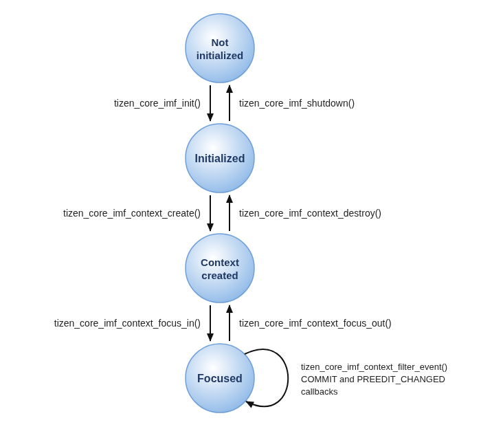

# Tizen Core IMF

The Tizen Core Input Method Framework (IMF) connects the text input fields of your application with the input method, such as a virtual keyboard.
Using the Tizen Core IMF API, you can receive text entered through the input method, show and hide the input panel, and configure the input panel for each text input field.

When your application initializes the IMF, the framework loads an input method module. For each text input field, your application creates an IMF context. The input method module connects the IMF context with the input method editor (IME) through the display server, and delivers the text and events of the IME to your application as callbacks.

The main features of the Tizen Core IMF API include:

- Preparing the IMF for use

  You can [initialize the IMF and create IMF contexts](#prerequisites) for your text input fields.

- Using basic IMF processes

  The [basic processes](#basic-tizen-core-imf-processes) allow you to [set and unset callbacks](#set-and-unset-callbacks), [manage the focus](#manage-the-focus), [control the input panel](#control-the-input-panel), and [filter key events](#filter-key-events). You can also [set the IMF context attributes](#imf-context-attributes).

- Retrieving IMF information

  You can [get information](#imf-information-retrieval) such as the state, geometry, and language of the input panel, and the preedit string.

- Monitoring the input panel of the system

  You can [monitor the global input panel](#monitor-the-global-input-panel) regardless of which IMF context uses it.

## Basic Tizen Core IMF processes

Using the Tizen Core IMF, you can:

- Initialize the IMF and create IMF contexts.
  - Initialize the IMF once at application startup. The initialization loads the input method module.
  - Create an IMF context for each text input field, and associate the window that contains the field with the context.
- Register callback functions.
  - [Get the text entered by the user](#set-and-unset-callbacks) as a committed string, and the text still being composed as a preedit string.
  - Get notifications when the input method requests to delete text around the cursor, set the selection, or commit content.
  - [Get notifications about the input panel](#set-and-unset-input-panel-event-callbacks), such as state, language, and geometry changes.
- Manage the focus and the input panel.
  - [Set the focus](#manage-the-focus) of the IMF context when the text input field gets the focus. The input method sends text only to the focused IMF context.
  - [Show and hide the input panel](#control-the-input-panel), and set its position.
  - [Pass key events to the input method](#filter-key-events) before your application processes them.
- Configure the input panel.
  - [Set the layout, return key, input hints, and other attributes](#set-the-imf-context-attributes) of the input panel for each IMF context.

The Tizen Core IMF life-cycle is described in the following figure.

**Figure: Tizen Core IMF life-cycle**



## IMF context attributes

You can set the following attributes for each IMF context. The input method applies the attributes when the IMF context gets the focus.

- Input panel layout

  The layout determines the key arrangement of the input panel, such as a number layout or an email address layout. The default layout is `TIZEN_CORE_IMF_INPUT_PANEL_LAYOUT_NORMAL`. You can refine some layouts with a layout variation.

- Return key

  You can set the type of the return key, such as **Done**, **Search**, or **Send**, and disable the return key, for example, while a required field is empty.

- Input hints

  The input hints tell the input method how to handle the text, for example, whether to suggest word completion or whether the text is sensitive data that must not be stored. The default input hint is `TIZEN_CORE_IMF_INPUT_HINTS_AUTO_COMPLETE`.

- Auto-capitalization

  The auto-capitalization type determines when the input method capitalizes letters. The default type is `TIZEN_CORE_IMF_AUTOCAPITAL_TYPE_SENTENCE`.

- Preferred language

  You can request the language of the input panel with a locale string, such as `"en_US"` or `"ko_KR"`. The input panel may not change its language based on this setting.

- BiDi direction

  You can set the text direction of the text input field. The default direction is `TIZEN_CORE_IMF_BIDI_DIRECTION_NEUTRAL`.

- Prediction hint

  You can pass a hint string that the input method can use for word prediction.

- Accepted MIME type

  You can set the MIME type of the content that the text input field accepts, for example, when the input method commits content such as an image.

- Input panel data

  You can pass application-specific data to the input method. The meaning of the data depends on the input method.

- Input panel position

  You can set the position of the input panel, optionally with an alignment.

- Input panel enabled state

  By default, the input panel is enabled and shown when the IMF context gets the focus. You can disable it, for example, when the user types with a hardware keyboard.

- Caps lock mode

  You can set the caps lock mode of the input panel.

## IMF information retrieval

You can get the following information about the IMF:

- [The state of the input panel](#get-information), which is shown, hidden, or about to be shown.
- The geometry of the input panel, to move your text input field so that the input panel does not cover it.
- The language locale currently used by the input panel, which can differ from the preferred language that you set.
- The keyboard mode, which indicates whether a hardware keyboard or a software keyboard is active.
- The current preedit string and its style attributes.
- The surrounding text that the IMF context holds.
- The values of the IMF context attributes that you set.
- [The state and geometry of the input panel of the system](#monitor-the-global-input-panel), regardless of which IMF context uses it.

## Prerequisites

To enable your application to use the Tizen Core IMF functionality:

1. To use the functions and data types of the Tizen Core IMF API, include the `<tizen_core_imf.h>` header file in your application:

   ```c
   #include <tizen_core_imf.h>
   ```

   The Tizen Core IMF API works with the [Tizen Core](../applications/tizen-core/tizen-core.md) main loop. The examples in this guide assume that your application runs a Tizen Core task and creates a Tizen Core Wayland window.

2. Initialize the IMF with the `tizen_core_imf_init()` function. Call it only once at application startup, before you use any other Tizen Core IMF function:

   ```c
   void
   init_imf(void)
   {
       int ret;
       ret = tizen_core_imf_init();
       if (ret != TIZEN_CORE_IMF_ERROR_NONE)
           /* Error handling */
   }
   ```

   > **Note**
   >
   > The `tizen_core_imf_init()` and `tizen_core_imf_shutdown()` functions are not thread-safe. Call `tizen_core_imf_init()` before you create any threads that use IMF functions, and call `tizen_core_imf_shutdown()` after all IMF operations in other threads have completed. Do not call `tizen_core_imf_init()` again without calling `tizen_core_imf_shutdown()` first.

3. Create an IMF context for each text input field with the `tizen_core_imf_context_create()` function.
   The IMF context handle is used in other Tizen Core IMF functions as a parameter:

   ```c
   typedef struct {
       char *text;
       int cursor_pos;
       char *preedit_string;
       tizen_core_imf_context_h imf_context;
   } entry_s;

   static entry_s entry;

   void
   create_imf_context(entry_s *en)
   {
       int ret;
       ret = tizen_core_imf_context_create(&en->imf_context);
       if (ret != TIZEN_CORE_IMF_ERROR_NONE)
           /* Error handling */

       en->text = strdup("");
       en->cursor_pos = 0;
       en->preedit_string = NULL;
   }
   ```

4. Associate the window that contains the text input field with the IMF context, using the `tizen_core_imf_context_set_client_window()` function.
   The input method uses this window as the target of input events and the input panel:

   ```c
   void
   set_client_window(entry_s *en, tizen_core_wl_window_h window)
   {
       int ret;
       ret = tizen_core_imf_context_set_client_window(en->imf_context, (void *)window);
       if (ret != TIZEN_CORE_IMF_ERROR_NONE)
           /* Error handling */
   }
   ```

5. When you no longer need the IMF context, destroy it with the `tizen_core_imf_context_destroy()` function:

   ```c
   void
   destroy_imf_context(entry_s *en)
   {
       int ret;
       ret = tizen_core_imf_context_destroy(en->imf_context);
       if (ret != TIZEN_CORE_IMF_ERROR_NONE)
           /* Error handling */

       en->imf_context = NULL;
   }
   ```

   > **Note**
   >
   > Do not destroy the IMF context in a callback. The `ctx` parameter of a callback can be used only within the callback.

6. When the IMF is no longer needed, destroy all IMF contexts and shut down the IMF with the `tizen_core_imf_shutdown()` function:

   ```c
   void
   shutdown_imf(void)
   {
       int ret;
       ret = tizen_core_imf_shutdown();
       if (ret != TIZEN_CORE_IMF_ERROR_NONE)
           /* Error handling */
   }
   ```

## Set and unset callbacks

The input method sends text and requests to your application through callbacks registered for each IMF context. The enum values, as well as the parameter details, for the callback parameters are defined in the `tizen_core_imf.h` header file.

To register a callback, use the `tizen_core_imf_context_add_event_cb()` function with a callback type. You can register several callbacks for the same callback type. To remove a callback, call the `tizen_core_imf_context_del_event_cb()` function with the same callback type, callback function, and user data that you used to register it.

All callbacks have the same signature. The content of the `event_info` parameter depends on the callback type, as described for each callback below. The `event_info` must not be released; it is available only in the callback. To use it outside the callback, make a copy.

The input method sends text to your application in 2 forms:

- A *preedit string* is text that the user is still composing, such as a Korean syllable in progress or a word that the input method may still correct. Display it in the text input field, usually with an underline, but do not add it to the text yet.
- A *committed string* is text that the user has finished entering. Add it to the text of the text input field.

You can use the following callbacks:

- Commit

  The `TIZEN_CORE_IMF_CALLBACK_COMMIT` callback is invoked when the user has entered a complete input sequence. The `event_info` is the committed string (`const char *`). Insert the string at the cursor position, and notify the input method of the new cursor position:

  ```c
  /* Callback */
  static void
  commit_cb(tizen_core_imf_context_h ctx, void *event_info, void *user_data)
  {
      entry_s *en = user_data;
      const char *commit_str = event_info;

      if (!commit_str)
          return;

      /* The preedit string is replaced by the committed string */
      free(en->preedit_string);
      en->preedit_string = NULL;

      /* Insert the committed string at the cursor position */
      size_t old_len = strlen(en->text);
      size_t commit_len = strlen(commit_str);
      char *new_text = malloc(old_len + commit_len + 1);
      if (!new_text)
          return;

      memcpy(new_text, en->text, en->cursor_pos);
      memcpy(new_text + en->cursor_pos, commit_str, commit_len);
      memcpy(new_text + en->cursor_pos + commit_len, en->text + en->cursor_pos,
             old_len - en->cursor_pos + 1);

      free(en->text);
      en->text = new_text;
      en->cursor_pos += commit_len;

      tizen_core_imf_context_set_cursor_position(ctx, en->cursor_pos);

      /* Redraw the text input field */
  }

  /* Set */
  void
  set_commit_cb(entry_s *en)
  {
      int ret;
      ret = tizen_core_imf_context_add_event_cb(en->imf_context, TIZEN_CORE_IMF_CALLBACK_COMMIT, commit_cb, en);
      if (ret != TIZEN_CORE_IMF_ERROR_NONE)
          /* Error handling */
  }

  /* Unset */
  void
  unset_commit_cb(entry_s *en)
  {
      int ret;
      ret = tizen_core_imf_context_del_event_cb(en->imf_context, TIZEN_CORE_IMF_CALLBACK_COMMIT, commit_cb, en);
      if (ret != TIZEN_CORE_IMF_ERROR_NONE)
          /* Error handling */
  }
  ```

- Preedit changed

  The `TIZEN_CORE_IMF_CALLBACK_PREEDIT_CHANGED` callback is invoked when the preedit string has changed. The `event_info` is `NULL`.
  In the callback, get the current preedit string with the `tizen_core_imf_context_get_preedit_string()` function. The function also returns the preedit attributes, which describe the style of each byte range in the preedit string, and the cursor position in the preedit string.
  Release the preedit string with `free()` and the attribute array with the `tizen_core_imf_preedit_attrs_destroy()` function:

  ```c
  /* Callback */
  static void
  preedit_changed_cb(tizen_core_imf_context_h ctx, void *event_info, void *user_data)
  {
      entry_s *en = user_data;
      char *preedit_string = NULL;
      tizen_core_imf_preedit_attr_h *attrs = NULL;
      int attrs_count = 0;
      int cursor_pos = 0;

      if (tizen_core_imf_context_get_preedit_string(ctx, &preedit_string, &attrs,
                                                    &attrs_count, &cursor_pos) != TIZEN_CORE_IMF_ERROR_NONE)
          return;

      for (int i = 0; i < attrs_count; i++) {
          tizen_core_imf_preedit_type_e type;
          unsigned int start_index = 0;
          unsigned int end_index = 0;

          tizen_core_imf_preedit_attr_get_preedit_type(attrs[i], &type);
          tizen_core_imf_preedit_attr_get_start_index(attrs[i], &start_index);
          tizen_core_imf_preedit_attr_get_end_index(attrs[i], &end_index);

          /* Apply the style of the type to the byte range from start_index to end_index */
      }

      free(en->preedit_string);
      en->preedit_string = NULL;
      if (preedit_string && preedit_string[0] != '\0')
          en->preedit_string = strdup(preedit_string);

      /* Redraw the text input field */

      free(preedit_string);
      if (attrs)
          tizen_core_imf_preedit_attrs_destroy(attrs, attrs_count);
  }

  /* Set */
  void
  set_preedit_changed_cb(entry_s *en)
  {
      int ret;
      ret = tizen_core_imf_context_add_event_cb(en->imf_context, TIZEN_CORE_IMF_CALLBACK_PREEDIT_CHANGED,
                                                preedit_changed_cb, en);
      if (ret != TIZEN_CORE_IMF_ERROR_NONE)
          /* Error handling */
  }

  /* Unset */
  void
  unset_preedit_changed_cb(entry_s *en)
  {
      int ret;
      ret = tizen_core_imf_context_del_event_cb(en->imf_context, TIZEN_CORE_IMF_CALLBACK_PREEDIT_CHANGED,
                                                preedit_changed_cb, en);
      if (ret != TIZEN_CORE_IMF_ERROR_NONE)
          /* Error handling */
  }
  ```

  The following table lists the preedit attribute types.

  **Table: Preedit attribute types**

  | Type | Description |
  |------|-------------|
  | `TIZEN_CORE_IMF_PREEDIT_TYPE_NONE` | No style |
  | `TIZEN_CORE_IMF_PREEDIT_TYPE_UNDERLINE` | Underline |
  | `TIZEN_CORE_IMF_PREEDIT_TYPE_REVERSE` | Reverse |
  | `TIZEN_CORE_IMF_PREEDIT_TYPE_HIGHLIGHT` | Highlight |

- Preedit start and end

  The `TIZEN_CORE_IMF_CALLBACK_PREEDIT_START` callback is invoked when a new preedit sequence starts, and the `TIZEN_CORE_IMF_CALLBACK_PREEDIT_END` callback is invoked when a preedit sequence has been completed or canceled. The `event_info` is `NULL`:

  ```c
  /* Callback */
  static void
  preedit_start_cb(tizen_core_imf_context_h ctx, void *event_info, void *user_data)
  {
      dlog_print(DLOG_INFO, LOG_TAG, "preedit started");
  }

  static void
  preedit_end_cb(tizen_core_imf_context_h ctx, void *event_info, void *user_data)
  {
      dlog_print(DLOG_INFO, LOG_TAG, "preedit ended");
  }

  /* Set */
  void
  set_preedit_start_end_cb(entry_s *en)
  {
      tizen_core_imf_context_add_event_cb(en->imf_context, TIZEN_CORE_IMF_CALLBACK_PREEDIT_START,
                                          preedit_start_cb, en);
      tizen_core_imf_context_add_event_cb(en->imf_context, TIZEN_CORE_IMF_CALLBACK_PREEDIT_END,
                                          preedit_end_cb, en);
  }

  /* Unset */
  void
  unset_preedit_start_end_cb(entry_s *en)
  {
      tizen_core_imf_context_del_event_cb(en->imf_context, TIZEN_CORE_IMF_CALLBACK_PREEDIT_START,
                                          preedit_start_cb, en);
      tizen_core_imf_context_del_event_cb(en->imf_context, TIZEN_CORE_IMF_CALLBACK_PREEDIT_END,
                                          preedit_end_cb, en);
  }
  ```

- Private command

  The `TIZEN_CORE_IMF_CALLBACK_PRIVATE_COMMAND_SEND` callback is invoked when the input method sends a private command. The `event_info` is the command string (`const char *`). The meaning of the command depends on the input method:

  ```c
  /* Callback */
  static void
  private_command_cb(tizen_core_imf_context_h ctx, void *event_info, void *user_data)
  {
      const char *command = event_info;

      dlog_print(DLOG_INFO, LOG_TAG, "private command : %s", command ? command : "");
  }

  /* Set */
  void
  set_private_command_cb(entry_s *en)
  {
      int ret;
      ret = tizen_core_imf_context_add_event_cb(en->imf_context, TIZEN_CORE_IMF_CALLBACK_PRIVATE_COMMAND_SEND,
                                                private_command_cb, en);
      if (ret != TIZEN_CORE_IMF_ERROR_NONE)
          /* Error handling */
  }

  /* Unset */
  void
  unset_private_command_cb(entry_s *en)
  {
      int ret;
      ret = tizen_core_imf_context_del_event_cb(en->imf_context, TIZEN_CORE_IMF_CALLBACK_PRIVATE_COMMAND_SEND,
                                                private_command_cb, en);
      if (ret != TIZEN_CORE_IMF_ERROR_NONE)
          /* Error handling */
  }
  ```

- Transaction start and end

  The input method can group several changes, such as a preedit change and a commit, into a transaction. The `TIZEN_CORE_IMF_CALLBACK_TRANSACTION_START` callback is invoked when a transaction starts, and the `TIZEN_CORE_IMF_CALLBACK_TRANSACTION_END` callback is invoked when it ends. The `event_info` is `NULL`.
  To avoid flickering, you can postpone redrawing the text input field until the transaction ends:

  ```c
  static bool in_transaction;

  /* Callback */
  static void
  transaction_start_cb(tizen_core_imf_context_h ctx, void *event_info, void *user_data)
  {
      in_transaction = true;
  }

  static void
  transaction_end_cb(tizen_core_imf_context_h ctx, void *event_info, void *user_data)
  {
      in_transaction = false;
      /* Redraw the text input field */
  }

  /* Set */
  void
  set_transaction_cb(entry_s *en)
  {
      tizen_core_imf_context_add_event_cb(en->imf_context, TIZEN_CORE_IMF_CALLBACK_TRANSACTION_START,
                                          transaction_start_cb, en);
      tizen_core_imf_context_add_event_cb(en->imf_context, TIZEN_CORE_IMF_CALLBACK_TRANSACTION_END,
                                          transaction_end_cb, en);
  }

  /* Unset */
  void
  unset_transaction_cb(entry_s *en)
  {
      tizen_core_imf_context_del_event_cb(en->imf_context, TIZEN_CORE_IMF_CALLBACK_TRANSACTION_START,
                                          transaction_start_cb, en);
      tizen_core_imf_context_del_event_cb(en->imf_context, TIZEN_CORE_IMF_CALLBACK_TRANSACTION_END,
                                          transaction_end_cb, en);
  }
  ```

- Delete surrounding, selection set, and commit content

  The `TIZEN_CORE_IMF_CALLBACK_DELETE_SURROUNDING` callback is invoked when the input method needs to delete all or part of the text around the cursor, the `TIZEN_CORE_IMF_CALLBACK_SELECTION_SET` callback is invoked when the input method needs to set the selection, and the `TIZEN_CORE_IMF_CALLBACK_COMMIT_CONTENT` callback is invoked when the input method commits content, such as an image.
  You can register and unregister these callbacks in the same way as the other callbacks. However, the C API does not define the content of the `event_info` for these callback types.

The following table lists all callback types.

**Table: IMF callback types**

| Callback type | Description | `event_info` |
|---------------|-------------|--------------|
| `TIZEN_CORE_IMF_CALLBACK_PREEDIT_START` | Called when a new preedit sequence starts. | `NULL` |
| `TIZEN_CORE_IMF_CALLBACK_PREEDIT_END` | Called when a preedit sequence has been completed or canceled. | `NULL` |
| `TIZEN_CORE_IMF_CALLBACK_PREEDIT_CHANGED` | Called when the preedit string has changed. | `NULL` |
| `TIZEN_CORE_IMF_CALLBACK_COMMIT` | Called when the user has entered a complete input sequence. | Committed string (`const char *`) |
| `TIZEN_CORE_IMF_CALLBACK_DELETE_SURROUNDING` | Called when the input method needs to delete all or part of the text around the cursor. | Not defined in the C API |
| `TIZEN_CORE_IMF_CALLBACK_SELECTION_SET` | Called when the input method needs to set the selection. | Not defined in the C API |
| `TIZEN_CORE_IMF_CALLBACK_PRIVATE_COMMAND_SEND` | Called when the input method sends a private command. | Command string (`const char *`) |
| `TIZEN_CORE_IMF_CALLBACK_COMMIT_CONTENT` | Called when the input method commits content, such as an image. | Not defined in the C API |
| `TIZEN_CORE_IMF_CALLBACK_TRANSACTION_START` | Called when a transaction sequence starts. | `NULL` |
| `TIZEN_CORE_IMF_CALLBACK_TRANSACTION_END` | Called when a transaction sequence ends. | `NULL` |

### Set and unset input panel event callbacks

To receive notifications about the input panel shown for an IMF context, register a callback with the `tizen_core_imf_context_add_input_panel_event_cb()` function. To remove it, call the `tizen_core_imf_context_del_input_panel_event_cb()` function with the same event type, callback function, and user data.

You can use the following input panel events:

- State changed

  The `TIZEN_CORE_IMF_INPUT_PANEL_EVENT_STATE` event is sent when the state of the input panel changes. The `value` parameter is one of the `tizen_core_imf_input_panel_state_e` values:

  ```c
  /* Callback */
  static void
  input_panel_state_cb(tizen_core_imf_context_h ctx, int value, void *user_data)
  {
      int x, y, w, h;

      switch (value) {
      case TIZEN_CORE_IMF_INPUT_PANEL_STATE_SHOW:
          tizen_core_imf_context_get_input_panel_geometry(ctx, &x, &y, &w, &h);
          dlog_print(DLOG_INFO, LOG_TAG, "input panel shown (%d, %d, %d x %d)", x, y, w, h);
          /* Move the text input field so that the input panel does not cover it */
          break;
      case TIZEN_CORE_IMF_INPUT_PANEL_STATE_HIDE:
          dlog_print(DLOG_INFO, LOG_TAG, "input panel hidden");
          break;
      case TIZEN_CORE_IMF_INPUT_PANEL_STATE_WILL_SHOW:
          dlog_print(DLOG_INFO, LOG_TAG, "input panel will be shown");
          break;
      default:
          break;
      }
  }

  /* Set */
  void
  set_input_panel_state_cb(entry_s *en)
  {
      int ret;
      ret = tizen_core_imf_context_add_input_panel_event_cb(en->imf_context, TIZEN_CORE_IMF_INPUT_PANEL_EVENT_STATE,
                                                            input_panel_state_cb, en);
      if (ret != TIZEN_CORE_IMF_ERROR_NONE)
          /* Error handling */
  }

  /* Unset */
  void
  unset_input_panel_state_cb(entry_s *en)
  {
      int ret;
      ret = tizen_core_imf_context_del_input_panel_event_cb(en->imf_context, TIZEN_CORE_IMF_INPUT_PANEL_EVENT_STATE,
                                                            input_panel_state_cb, en);
      if (ret != TIZEN_CORE_IMF_ERROR_NONE)
          /* Error handling */
  }
  ```

- Language changed

  The `TIZEN_CORE_IMF_INPUT_PANEL_EVENT_LANGUAGE` event is sent when the language of the input panel changes. Get the new language with the `tizen_core_imf_context_get_input_panel_language_locale()` function, and release it with `free()`:

  ```c
  /* Callback */
  static void
  input_panel_language_cb(tizen_core_imf_context_h ctx, int value, void *user_data)
  {
      char *locale = NULL;

      if (tizen_core_imf_context_get_input_panel_language_locale(ctx, &locale) == TIZEN_CORE_IMF_ERROR_NONE) {
          dlog_print(DLOG_INFO, LOG_TAG, "input panel language : %s", locale ? locale : "");
          free(locale);
      }
  }

  /* Set */
  void
  set_input_panel_language_cb(entry_s *en)
  {
      tizen_core_imf_context_add_input_panel_event_cb(en->imf_context, TIZEN_CORE_IMF_INPUT_PANEL_EVENT_LANGUAGE,
                                                      input_panel_language_cb, en);
  }

  /* Unset */
  void
  unset_input_panel_language_cb(entry_s *en)
  {
      tizen_core_imf_context_del_input_panel_event_cb(en->imf_context, TIZEN_CORE_IMF_INPUT_PANEL_EVENT_LANGUAGE,
                                                      input_panel_language_cb, en);
  }
  ```

- Geometry changed

  The `TIZEN_CORE_IMF_INPUT_PANEL_EVENT_GEOMETRY` event is sent when the size of the input panel changes. Get the new geometry with the `tizen_core_imf_context_get_input_panel_geometry()` function:

  ```c
  /* Callback */
  static void
  input_panel_geometry_cb(tizen_core_imf_context_h ctx, int value, void *user_data)
  {
      int x, y, w, h;

      tizen_core_imf_context_get_input_panel_geometry(ctx, &x, &y, &w, &h);
      dlog_print(DLOG_INFO, LOG_TAG, "input panel geometry : (%d, %d, %d x %d)", x, y, w, h);
  }

  /* Set */
  void
  set_input_panel_geometry_cb(entry_s *en)
  {
      tizen_core_imf_context_add_input_panel_event_cb(en->imf_context, TIZEN_CORE_IMF_INPUT_PANEL_EVENT_GEOMETRY,
                                                      input_panel_geometry_cb, en);
  }

  /* Unset */
  void
  unset_input_panel_geometry_cb(entry_s *en)
  {
      tizen_core_imf_context_del_input_panel_event_cb(en->imf_context, TIZEN_CORE_IMF_INPUT_PANEL_EVENT_GEOMETRY,
                                                      input_panel_geometry_cb, en);
  }
  ```

- Shift mode and keyboard mode changed

  The `TIZEN_CORE_IMF_INPUT_PANEL_EVENT_SHIFT_MODE` event is sent when the shift key state of the input panel changes, and the `TIZEN_CORE_IMF_INPUT_PANEL_EVENT_KEYBOARD_MODE` event is sent when the keyboard mode changes between the hardware keyboard and the software keyboard. The `value` parameter is sent by the input method. To get the current keyboard mode, use the `tizen_core_imf_context_get_keyboard_mode()` function:

  ```c
  /* Callback */
  static void
  keyboard_mode_cb(tizen_core_imf_context_h ctx, int value, void *user_data)
  {
      tizen_core_imf_input_panel_keyboard_mode_e mode;

      if (tizen_core_imf_context_get_keyboard_mode(ctx, &mode) == TIZEN_CORE_IMF_ERROR_NONE)
          dlog_print(DLOG_INFO, LOG_TAG, "keyboard mode : %s",
                     mode == TIZEN_CORE_IMF_INPUT_PANEL_KEYBOARD_MODE_HW ? "hardware" : "software");
  }

  /* Set */
  void
  set_keyboard_mode_cb(entry_s *en)
  {
      tizen_core_imf_context_add_input_panel_event_cb(en->imf_context, TIZEN_CORE_IMF_INPUT_PANEL_EVENT_KEYBOARD_MODE,
                                                      keyboard_mode_cb, en);
  }

  /* Unset */
  void
  unset_keyboard_mode_cb(entry_s *en)
  {
      tizen_core_imf_context_del_input_panel_event_cb(en->imf_context, TIZEN_CORE_IMF_INPUT_PANEL_EVENT_KEYBOARD_MODE,
                                                      keyboard_mode_cb, en);
  }
  ```

The following table lists the input panel event types.

**Table: Input panel event types**

| Event type | Description |
|------------|-------------|
| `TIZEN_CORE_IMF_INPUT_PANEL_EVENT_STATE` | Called when the state of the input panel changes. The `value` is a `tizen_core_imf_input_panel_state_e` value. |
| `TIZEN_CORE_IMF_INPUT_PANEL_EVENT_LANGUAGE` | Called when the language of the input panel changes. |
| `TIZEN_CORE_IMF_INPUT_PANEL_EVENT_SHIFT_MODE` | Called when the shift key state of the input panel changes. |
| `TIZEN_CORE_IMF_INPUT_PANEL_EVENT_GEOMETRY` | Called when the size of the input panel changes. |
| `TIZEN_CORE_IMF_INPUT_PANEL_EVENT_KEYBOARD_MODE` | Called when the keyboard mode changes between the hardware keyboard and the software keyboard. |

### Set the retrieve surrounding callback

The input method can use the text around the cursor to provide features such as word prediction and auto-capitalization. To provide the surrounding text, set a callback with the `tizen_core_imf_context_set_retrieve_surrounding_cb()` function.
In the callback, allocate the text with a function such as `strdup()`. The framework releases the text after use:

```c
/* Callback */
static void
retrieve_surrounding_cb(tizen_core_imf_context_h ctx, char **text, int *cursor_pos, void *user_data)
{
    entry_s *en = user_data;

    if (text)
        *text = strdup(en->text ? en->text : "");

    if (cursor_pos)
        *cursor_pos = en->cursor_pos;
}

/* Set */
void
set_retrieve_surrounding_cb(entry_s *en)
{
    int ret;
    ret = tizen_core_imf_context_set_retrieve_surrounding_cb(en->imf_context, retrieve_surrounding_cb, en);
    if (ret != TIZEN_CORE_IMF_ERROR_NONE)
        /* Error handling */
}
```

## Get information

To get information about the input panel and the IMF context, use the following functions. Release the outputs that the table marks with `free()`.

- Get the input panel state:

  ```c
  void
  get_input_panel_state(entry_s *en)
  {
      tizen_core_imf_input_panel_state_e state;
      int ret;

      ret = tizen_core_imf_context_get_input_panel_state(en->imf_context, &state);
      if (ret != TIZEN_CORE_IMF_ERROR_NONE)
          /* Error handling */
  }
  ```

- Get the input panel geometry:

  ```c
  void
  get_input_panel_geometry(entry_s *en)
  {
      int x, y, w, h;
      int ret;

      ret = tizen_core_imf_context_get_input_panel_geometry(en->imf_context, &x, &y, &w, &h);
      if (ret != TIZEN_CORE_IMF_ERROR_NONE)
          /* Error handling */
  }
  ```

- Get the language locale currently used by the input panel. Release the locale string with `free()`:

  ```c
  void
  get_input_panel_language(entry_s *en)
  {
      char *locale = NULL;
      int ret;

      ret = tizen_core_imf_context_get_input_panel_language_locale(en->imf_context, &locale);
      if (ret != TIZEN_CORE_IMF_ERROR_NONE)
          /* Error handling */

      free(locale);
  }
  ```

- Get the keyboard mode:

  ```c
  void
  get_keyboard_mode(entry_s *en)
  {
      tizen_core_imf_input_panel_keyboard_mode_e mode;
      int ret;

      ret = tizen_core_imf_context_get_keyboard_mode(en->imf_context, &mode);
      if (ret != TIZEN_CORE_IMF_ERROR_NONE)
          /* Error handling */
  }
  ```

- Get the surrounding text that the IMF context holds. Release the text with `free()`:

  ```c
  void
  get_surrounding(entry_s *en)
  {
      char *text = NULL;
      int cursor_pos = 0;
      int ret;

      ret = tizen_core_imf_context_get_surrounding(en->imf_context, &text, &cursor_pos);
      if (ret != TIZEN_CORE_IMF_ERROR_NONE)
          /* Error handling */

      free(text);
  }
  ```

- Get the input panel data that you set. Release the data with `free()`:

  ```c
  void
  get_input_panel_data(entry_s *en)
  {
      unsigned char *data = NULL;
      int len = 0;
      int ret;

      ret = tizen_core_imf_context_get_input_panel_data(en->imf_context, &data, &len);
      if (ret != TIZEN_CORE_IMF_ERROR_NONE)
          /* Error handling */

      free(data);
  }
  ```

The following table lists the functions that get information.

**Table: Functions to get information**

| Function | Information | Release |
|----------|-------------|---------|
| `tizen_core_imf_context_get_input_panel_state()` | Input panel state | - |
| `tizen_core_imf_context_get_input_panel_geometry()` | Input panel position and size | - |
| `tizen_core_imf_context_get_input_panel_language_locale()` | Language locale used by the input panel | `free()` |
| `tizen_core_imf_context_get_keyboard_mode()` | Hardware or software keyboard mode | - |
| `tizen_core_imf_context_get_preedit_string()` | Preedit string, preedit attributes, and cursor position | `free()` for the string, `tizen_core_imf_preedit_attrs_destroy()` for the attributes |
| `tizen_core_imf_context_get_surrounding()` | Surrounding text and cursor position | `free()` for the text |
| `tizen_core_imf_context_get_input_panel_data()` | Input panel data | `free()` |
| `tizen_core_imf_context_get_input_panel_layout()` | Input panel layout | - |
| `tizen_core_imf_context_get_input_panel_layout_variation()` | Input panel layout variation | - |
| `tizen_core_imf_context_get_input_panel_return_key_type()` | Return key type | - |
| `tizen_core_imf_context_get_input_panel_return_key_disabled()` | Whether the return key is disabled | - |
| `tizen_core_imf_context_get_input_hint()` | Input hints | - |
| `tizen_core_imf_context_get_autocapital_type()` | Auto-capitalization type | - |
| `tizen_core_imf_context_get_input_panel_caps_lock_mode()` | Caps lock mode | - |
| `tizen_core_imf_context_get_input_panel_enabled()` | Whether the input panel is enabled | - |

## Set the IMF context attributes

To configure the input panel for a text input field, set the attributes of its IMF context:

- Set the input panel layout. For example, use `TIZEN_CORE_IMF_INPUT_PANEL_LAYOUT_EMAIL` for an email address field:

  ```c
  void
  set_input_panel_layout(entry_s *en)
  {
      int ret;
      ret = tizen_core_imf_context_set_input_panel_layout(en->imf_context, TIZEN_CORE_IMF_INPUT_PANEL_LAYOUT_EMAIL);
      if (ret != TIZEN_CORE_IMF_ERROR_NONE)
          /* Error handling */
  }
  ```

  **Table: Input panel layouts**

  | Layout | Description |
  |--------|-------------|
  | `TIZEN_CORE_IMF_INPUT_PANEL_LAYOUT_NORMAL` | Default layout |
  | `TIZEN_CORE_IMF_INPUT_PANEL_LAYOUT_NUMBER` | Number layout |
  | `TIZEN_CORE_IMF_INPUT_PANEL_LAYOUT_EMAIL` | Email layout |
  | `TIZEN_CORE_IMF_INPUT_PANEL_LAYOUT_URL` | URL layout |
  | `TIZEN_CORE_IMF_INPUT_PANEL_LAYOUT_PHONENUMBER` | Phone number layout |
  | `TIZEN_CORE_IMF_INPUT_PANEL_LAYOUT_IP` | IP address layout |
  | `TIZEN_CORE_IMF_INPUT_PANEL_LAYOUT_MONTH` | Month layout |
  | `TIZEN_CORE_IMF_INPUT_PANEL_LAYOUT_NUMBERONLY` | Number-only layout |
  | `TIZEN_CORE_IMF_INPUT_PANEL_LAYOUT_PASSWORD` | Like the normal layout, but without auto-correction and auto-capitalization |
  | `TIZEN_CORE_IMF_INPUT_PANEL_LAYOUT_DATETIME` | Date and time layout |
  | `TIZEN_CORE_IMF_INPUT_PANEL_LAYOUT_EMOTICON` | Emoticon layout |
  | `TIZEN_CORE_IMF_INPUT_PANEL_LAYOUT_VOICE` | Voice layout. If the IME does not support the voice layout, the normal layout is shown. |

- Refine the layout with a layout variation. The valid values depend on the current layout; pass the value cast to `int`:

  ```c
  void
  set_input_panel_layout_variation(entry_s *en)
  {
      int ret;

      tizen_core_imf_context_set_input_panel_layout(en->imf_context, TIZEN_CORE_IMF_INPUT_PANEL_LAYOUT_NUMBERONLY);
      ret = tizen_core_imf_context_set_input_panel_layout_variation(en->imf_context,
                                                                    TIZEN_CORE_IMF_LAYOUT_NUMBERONLY_VARIATION_DECIMAL);
      if (ret != TIZEN_CORE_IMF_ERROR_NONE)
          /* Error handling */
  }
  ```

  **Table: Layout variations**

  | Layout | Variation values |
  |--------|------------------|
  | `TIZEN_CORE_IMF_INPUT_PANEL_LAYOUT_NORMAL` | `TIZEN_CORE_IMF_LAYOUT_NORMAL_VARIATION_NORMAL`, `TIZEN_CORE_IMF_LAYOUT_NORMAL_VARIATION_FILENAME` (symbols such as `/` are disabled), `TIZEN_CORE_IMF_LAYOUT_NORMAL_VARIATION_PERSON_NAME` |
  | `TIZEN_CORE_IMF_INPUT_PANEL_LAYOUT_NUMBERONLY` | `TIZEN_CORE_IMF_LAYOUT_NUMBERONLY_VARIATION_NORMAL`, `TIZEN_CORE_IMF_LAYOUT_NUMBERONLY_VARIATION_SIGNED`, `TIZEN_CORE_IMF_LAYOUT_NUMBERONLY_VARIATION_DECIMAL`, `TIZEN_CORE_IMF_LAYOUT_NUMBERONLY_VARIATION_SIGNED_AND_DECIMAL` |
  | `TIZEN_CORE_IMF_INPUT_PANEL_LAYOUT_PASSWORD` | `TIZEN_CORE_IMF_LAYOUT_PASSWORD_VARIATION_NORMAL`, `TIZEN_CORE_IMF_LAYOUT_PASSWORD_VARIATION_NUMBERONLY` |
  | Other layouts | Not supported. Pass `0`. |

- Set the type of the return key, and disable the return key when needed:

  ```c
  void
  set_return_key(entry_s *en)
  {
      tizen_core_imf_context_set_input_panel_return_key_type(en->imf_context,
                                                              TIZEN_CORE_IMF_INPUT_PANEL_RETURN_KEY_TYPE_SEARCH);

      /* Disable the return key while the field is empty */
      tizen_core_imf_context_set_input_panel_return_key_disabled(en->imf_context, en->text[0] == '\0');
  }
  ```

  **Table: Return key types**

  | Type | Description |
  |------|-------------|
  | `TIZEN_CORE_IMF_INPUT_PANEL_RETURN_KEY_TYPE_DEFAULT` | Default |
  | `TIZEN_CORE_IMF_INPUT_PANEL_RETURN_KEY_TYPE_DONE` | Done |
  | `TIZEN_CORE_IMF_INPUT_PANEL_RETURN_KEY_TYPE_GO` | Go |
  | `TIZEN_CORE_IMF_INPUT_PANEL_RETURN_KEY_TYPE_JOIN` | Join |
  | `TIZEN_CORE_IMF_INPUT_PANEL_RETURN_KEY_TYPE_LOGIN` | Login |
  | `TIZEN_CORE_IMF_INPUT_PANEL_RETURN_KEY_TYPE_NEXT` | Next |
  | `TIZEN_CORE_IMF_INPUT_PANEL_RETURN_KEY_TYPE_SEARCH` | Search or magnifier icon |
  | `TIZEN_CORE_IMF_INPUT_PANEL_RETURN_KEY_TYPE_SEND` | Send |
  | `TIZEN_CORE_IMF_INPUT_PANEL_RETURN_KEY_TYPE_SIGNIN` | Sign-in |

- Set the input hints. You can combine the values with the bitwise OR operator:

  ```c
  void
  set_input_hint(entry_s *en)
  {
      int ret;
      ret = tizen_core_imf_context_set_input_hint(en->imf_context,
                                                  TIZEN_CORE_IMF_INPUT_HINTS_AUTO_COMPLETE | TIZEN_CORE_IMF_INPUT_HINTS_MULTILINE);
      if (ret != TIZEN_CORE_IMF_ERROR_NONE)
          /* Error handling */
  }
  ```

  **Table: Input hints**

  | Hint | Description |
  |------|-------------|
  | `TIZEN_CORE_IMF_INPUT_HINTS_NONE` | No hints |
  | `TIZEN_CORE_IMF_INPUT_HINTS_AUTO_COMPLETE` | Suggest word auto-completion |
  | `TIZEN_CORE_IMF_INPUT_HINTS_SENSITIVE_DATA` | The typed text must not be stored |
  | `TIZEN_CORE_IMF_INPUT_HINTS_MULTILINE` | Multiline text |
  | `TIZEN_CORE_IMF_INPUT_HINTS_FULLSCREEN_MODE` | Show the input panel in fullscreen mode |

- Set the auto-capitalization type:

  ```c
  void
  set_autocapital_type(entry_s *en)
  {
      int ret;
      ret = tizen_core_imf_context_set_autocapital_type(en->imf_context, TIZEN_CORE_IMF_AUTOCAPITAL_TYPE_WORD);
      if (ret != TIZEN_CORE_IMF_ERROR_NONE)
          /* Error handling */
  }
  ```

  **Table: Auto-capitalization types**

  | Type | Description |
  |------|-------------|
  | `TIZEN_CORE_IMF_AUTOCAPITAL_TYPE_NONE` | No auto-capitalization |
  | `TIZEN_CORE_IMF_AUTOCAPITAL_TYPE_WORD` | Capitalize each word |
  | `TIZEN_CORE_IMF_AUTOCAPITAL_TYPE_SENTENCE` | Capitalize the start of each sentence |
  | `TIZEN_CORE_IMF_AUTOCAPITAL_TYPE_ALLCHARACTER` | Capitalize all letters |

- Set the preferred language of the input panel:

  ```c
  void
  set_language_locale(entry_s *en)
  {
      int ret;
      ret = tizen_core_imf_context_set_input_panel_language_locale(en->imf_context, "ko_KR");
      if (ret != TIZEN_CORE_IMF_ERROR_NONE)
          /* Error handling */
  }
  ```

- Set the BiDi direction of the text input field to `TIZEN_CORE_IMF_BIDI_DIRECTION_NEUTRAL`, `TIZEN_CORE_IMF_BIDI_DIRECTION_LTR` (left to right), or `TIZEN_CORE_IMF_BIDI_DIRECTION_RTL` (right to left):

  ```c
  void
  set_bidi_direction(entry_s *en)
  {
      int ret;
      ret = tizen_core_imf_context_set_bidi_direction(en->imf_context, TIZEN_CORE_IMF_BIDI_DIRECTION_RTL);
      if (ret != TIZEN_CORE_IMF_ERROR_NONE)
          /* Error handling */
  }
  ```

- Set the prediction hint and the accepted MIME type:

  ```c
  void
  set_prediction_and_mime_type(entry_s *en)
  {
      tizen_core_imf_context_set_prediction_hint(en->imf_context, "Search keyword");
      tizen_core_imf_context_set_mime_type_accept(en->imf_context, "image/png");
  }
  ```

- Pass application-specific data to the input method. The data must not be `NULL`, and the length must be greater than 0. You cannot clear the data with this function:

  ```c
  void
  set_input_panel_data(entry_s *en)
  {
      const unsigned char data[] = "mode=compact";
      int ret;

      ret = tizen_core_imf_context_set_input_panel_data(en->imf_context, data, sizeof(data));
      if (ret != TIZEN_CORE_IMF_ERROR_NONE)
          /* Error handling */
  }
  ```

- Set the caps lock mode of the input panel:

  ```c
  void
  set_caps_lock_mode(entry_s *en)
  {
      int ret;
      ret = tizen_core_imf_context_set_input_panel_caps_lock_mode(en->imf_context, true);
      if (ret != TIZEN_CORE_IMF_ERROR_NONE)
          /* Error handling */
  }
  ```

The following example configures the input panel for a PIN field:

```c
void
configure_pin_field(entry_s *en)
{
    tizen_core_imf_context_set_input_panel_layout(en->imf_context, TIZEN_CORE_IMF_INPUT_PANEL_LAYOUT_PASSWORD);
    tizen_core_imf_context_set_input_panel_layout_variation(en->imf_context,
                                                            TIZEN_CORE_IMF_LAYOUT_PASSWORD_VARIATION_NUMBERONLY);
    tizen_core_imf_context_set_input_panel_return_key_type(en->imf_context,
                                                           TIZEN_CORE_IMF_INPUT_PANEL_RETURN_KEY_TYPE_LOGIN);
    tizen_core_imf_context_set_input_hint(en->imf_context, TIZEN_CORE_IMF_INPUT_HINTS_SENSITIVE_DATA);
    tizen_core_imf_context_set_autocapital_type(en->imf_context, TIZEN_CORE_IMF_AUTOCAPITAL_TYPE_NONE);
}
```

## Manage the focus

The input method sends text only to the IMF context that has the focus. Update the focus whenever the focus of your text input fields changes:

1. When a text input field gets the focus, notify the input method of the cursor position with the `tizen_core_imf_context_set_cursor_position()` function, and call the `tizen_core_imf_context_focus_in()` function. If the input panel is enabled, the input panel is shown:

   ```c
   void
   entry_focus_in(entry_s *en)
   {
       tizen_core_imf_context_set_cursor_position(en->imf_context, en->cursor_pos);
       tizen_core_imf_context_focus_in(en->imf_context);
   }
   ```

2. When a text input field loses the focus, call the `tizen_core_imf_context_reset()` function to commit the remaining preedit string, and then call the `tizen_core_imf_context_focus_out()` function:

   ```c
   void
   entry_focus_out(entry_s *en)
   {
       /* Flush the preedit string */
       tizen_core_imf_context_reset(en->imf_context);
       tizen_core_imf_context_focus_out(en->imf_context);
   }
   ```

When the cursor moves in the text input field, for example, because the user taps the text or deletes a character, notify the input method with the `tizen_core_imf_context_set_cursor_position()` function. The cursor position is a byte offset from the start of the text, and must be 0 or greater.

If your application changes the text of the field by itself, for example, when the user taps a **Clear** button, call the `tizen_core_imf_context_reset()` function so that the input method discards its current composition.

## Control the input panel

To control the input panel of an IMF context:

- Show or hide the input panel explicitly:

  ```c
  void
  show_input_panel(entry_s *en)
  {
      int ret;
      ret = tizen_core_imf_context_input_panel_show(en->imf_context);
      if (ret != TIZEN_CORE_IMF_ERROR_NONE)
          /* Error handling */
  }

  void
  hide_input_panel(entry_s *en)
  {
      int ret;
      ret = tizen_core_imf_context_input_panel_hide(en->imf_context);
      if (ret != TIZEN_CORE_IMF_ERROR_NONE)
          /* Error handling */
  }
  ```

- Prevent the input panel from being shown when the IMF context gets the focus, for example, when the user types with a hardware keyboard:

  ```c
  void
  disable_input_panel(entry_s *en)
  {
      int ret;
      ret = tizen_core_imf_context_set_input_panel_enabled(en->imf_context, false);
      if (ret != TIZEN_CORE_IMF_ERROR_NONE)
          /* Error handling */
  }
  ```

- Set the position of the input panel. With the `tizen_core_imf_context_set_input_panel_position_align()` function, the input panel is aligned to the given point according to the alignment value:

  ```c
  void
  set_input_panel_position(entry_s *en)
  {
      /* Place the top-left corner of the input panel at (0, 800) */
      tizen_core_imf_context_set_input_panel_position(en->imf_context, 0, 800);

      /* Place the bottom-center point of the input panel at (360, 1280) */
      tizen_core_imf_context_set_input_panel_position_align(en->imf_context, 360, 1280,
                                                            TIZEN_CORE_IMF_INPUT_PANEL_ALIGN_BOTTOM_CENTER);
  }
  ```

  The alignment is one of the `tizen_core_imf_input_panel_align_e` values: `TIZEN_CORE_IMF_INPUT_PANEL_ALIGN_TOP_LEFT`, `_TOP_CENTER`, `_TOP_RIGHT`, `_MIDDLE_LEFT`, `_MIDDLE_CENTER`, `_MIDDLE_RIGHT`, `_BOTTOM_LEFT`, `_BOTTOM_CENTER`, and `_BOTTOM_RIGHT`.

## Filter key events

When the IMF context has the focus, pass each key event of your window to the input method before your application processes it. The input method may consume the key, for example, to compose a character from several key presses.

To filter a key event:

1. Create a key event handle with the `tizen_core_imf_event_key_create()` function, and copy the information of the key event received from the window into it. The key event handle copies the strings that you set.
2. Call the `tizen_core_imf_context_filter_event()` function with the `TIZEN_CORE_IMF_EVENT_TYPE_KEY_DOWN` or `TIZEN_CORE_IMF_EVENT_TYPE_KEY_UP` event type.
3. If the `result` output parameter is `true`, the input method has consumed the key event, and your application must not process it.
4. Destroy the key event handle with the `tizen_core_imf_event_key_destroy()` function.

The following example filters a key event received from a Tizen Core Wayland window:

```c
static bool
filter_key_event(entry_s *en, tizen_core_imf_event_type_e type, const char *keyname,
                 unsigned int keycode, const char *dev_name, unsigned int timestamp)
{
    tizen_core_imf_event_key_h key_event = NULL;
    bool filtered = false;

    if (tizen_core_imf_event_key_create(&key_event) != TIZEN_CORE_IMF_ERROR_NONE)
        return false;

    tizen_core_imf_event_key_set_keyname(key_event, keyname);
    tizen_core_imf_event_key_set_key(key_event, keyname);
    tizen_core_imf_event_key_set_keycode(key_event, keycode);
    tizen_core_imf_event_key_set_device_name(key_event, dev_name);
    tizen_core_imf_event_key_set_device_class(key_event, TIZEN_CORE_IMF_DEVICE_CLASS_KEYBOARD);
    tizen_core_imf_event_key_set_device_subclass(key_event, TIZEN_CORE_IMF_DEVICE_SUBCLASS_NONE);
    tizen_core_imf_event_key_set_timestamp(key_event, timestamp);

    if (tizen_core_imf_context_filter_event(en->imf_context, type, key_event, &filtered) != TIZEN_CORE_IMF_ERROR_NONE)
        filtered = false;

    tizen_core_imf_event_key_destroy(key_event);

    return filtered;
}

/* In the key down event handler of the window */
if (filter_key_event(&entry, TIZEN_CORE_IMF_EVENT_TYPE_KEY_DOWN, keyname, keycode, dev_name, timestamp))
    return; /* The input method has consumed the key */

/* Process the key in the application */
```

The following table lists the attributes of a key event handle.

**Table: Key event attributes**

| Attribute | Set and get functions | Description |
|-----------|-----------------------|-------------|
| Key name | `tizen_core_imf_event_key_set_keyname()`, `tizen_core_imf_event_key_get_keyname()` | Name of the key, such as `"BackSpace"` |
| Key | `tizen_core_imf_event_key_set_key()`, `tizen_core_imf_event_key_get_key()` | Logical key value |
| String | `tizen_core_imf_event_key_set_string()`, `tizen_core_imf_event_key_get_string()` | String committed by the key |
| Compose | `tizen_core_imf_event_key_set_compose()`, `tizen_core_imf_event_key_get_compose()` | Compose string |
| Key code | `tizen_core_imf_event_key_set_keycode()`, `tizen_core_imf_event_key_get_keycode()` | Key scan code |
| Timestamp | `tizen_core_imf_event_key_set_timestamp()`, `tizen_core_imf_event_key_get_timestamp()` | Time of the event |
| Modifiers | `tizen_core_imf_event_key_set_modifiers()`, `tizen_core_imf_event_key_get_modifiers()` | Active modifier keys, a combination of the `tizen_core_imf_keyboard_modifiers_e` values |
| Locks | `tizen_core_imf_event_key_set_locks()`, `tizen_core_imf_event_key_get_locks()` | Active locks, a combination of the `tizen_core_imf_keyboard_locks_e` values |
| Device name | `tizen_core_imf_event_key_set_device_name()`, `tizen_core_imf_event_key_get_device_name()` | Name of the input device |
| Device class | `tizen_core_imf_event_key_set_device_class()`, `tizen_core_imf_event_key_get_device_class()` | Class of the input device, such as a keyboard |
| Device subclass | `tizen_core_imf_event_key_set_device_subclass()`, `tizen_core_imf_event_key_get_device_subclass()` | Subclass of the input device, such as a remote controller |

The strings returned by the `tizen_core_imf_event_key_get_*()` functions must not be released. They are available until the key event handle is destroyed or the value is changed.

> **Note**
>
> The `tizen_core_imf_event_type_e` enumeration also defines mouse event types, but the C API does not provide a mouse event handle. Filter only key events.

## Monitor the global input panel

To monitor the input panel regardless of which IMF context uses it, create an input panel handler with the `tizen_core_imf_input_panel_handler_create()` function, and register callbacks for the state and geometry changes:

```c
static tizen_core_imf_input_panel_handler_h handler;

/* Callback */
static void
global_input_panel_state_cb(tizen_core_imf_input_panel_state_e state, void *user_data)
{
    dlog_print(DLOG_INFO, LOG_TAG, "input panel state : %d", state);
}

static void
global_input_panel_geometry_cb(int x, int y, int w, int h, void *user_data)
{
    dlog_print(DLOG_INFO, LOG_TAG, "input panel geometry : (%d, %d, %d x %d)", x, y, w, h);
}

/* Set */
void
start_monitoring_input_panel(void)
{
    if (tizen_core_imf_input_panel_handler_create(&handler) != TIZEN_CORE_IMF_ERROR_NONE)
        return;

    tizen_core_imf_add_global_input_panel_state_cb(handler, global_input_panel_state_cb, NULL);
    tizen_core_imf_add_global_input_panel_geometry_cb(handler, global_input_panel_geometry_cb, NULL);
}

/* Unset */
void
stop_monitoring_input_panel(void)
{
    tizen_core_imf_del_global_input_panel_state_cb(handler, global_input_panel_state_cb, NULL);
    tizen_core_imf_del_global_input_panel_geometry_cb(handler, global_input_panel_geometry_cb, NULL);
    tizen_core_imf_input_panel_handler_destroy(handler);
    handler = NULL;
}
```

To get the current state and geometry of the input panel without a handler, use the `tizen_core_imf_get_global_input_panel_state()` and `tizen_core_imf_get_global_input_panel_geometry()` functions. The geometry function takes the rotation angle of your application window as a parameter:

```c
void
get_global_input_panel_info(int window_angle)
{
    tizen_core_imf_input_panel_state_e state;
    int x, y, w, h;

    tizen_core_imf_get_global_input_panel_state(&state);
    tizen_core_imf_get_global_input_panel_geometry(window_angle, &x, &y, &w, &h);
}
```

## Release resources

When you no longer need the Tizen Core IMF:

1. Remove the callbacks that you registered, as described in [Set and unset callbacks](#set-and-unset-callbacks).
2. Destroy the input panel handlers with the `tizen_core_imf_input_panel_handler_destroy()` function.
3. Destroy all IMF contexts with the `tizen_core_imf_context_destroy()` function.
4. Shut down the framework with the `tizen_core_imf_shutdown()` function.

```c
void
release_imf(entry_s *en)
{
    unset_commit_cb(en);
    unset_preedit_changed_cb(en);

    tizen_core_imf_context_destroy(en->imf_context);
    en->imf_context = NULL;

    tizen_core_imf_shutdown();
}
```

## Related information

- Dependencies
  - Since Tizen 11.0
