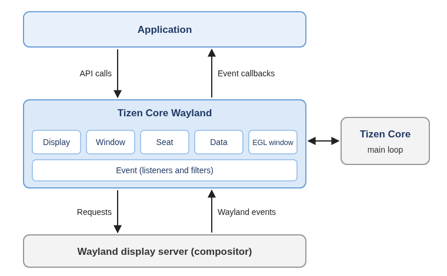
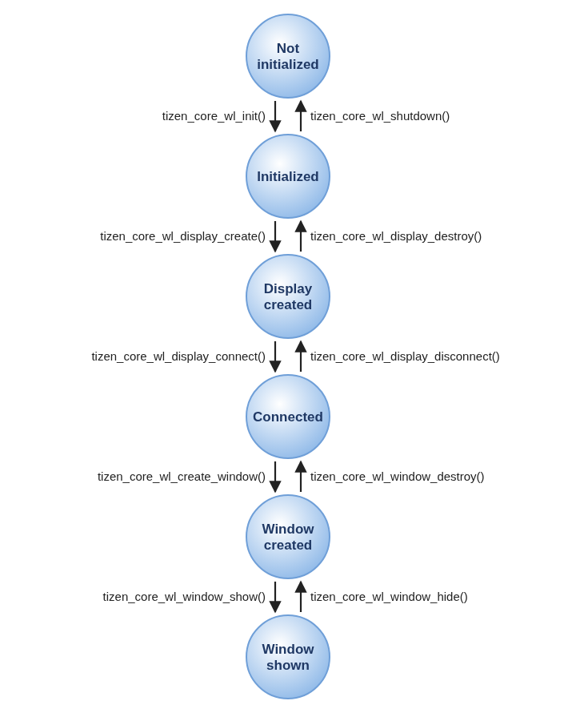

# Tizen Core Wayland

Tizen Core Wayland is a Wayland client-side windowing library that is built directly on [Tizen Core](../../applications/tizen-core/tizen-core.md) and the Wayland client libraries, without an EFL dependency.

When your application connects to the display server with the Tizen Core Wayland API, the library creates a Wayland connection and registers its event sources in the Tizen Core main loop of the calling thread. The display server, also called the Wayland compositor, and your application communicate as the server and the client. The library translates the Wayland protocol messages from the display server into Tizen Core Wayland events, and delivers them to the listeners that your application registers.

The main features of the Tizen Core Wayland API include:

- Connecting to the display server

  You can [connect to the display server](#connect-and-disconnect-the-display-server) and get notifications about the connection state.

- Using basic Tizen Core Wayland processes

  The [basic processes](#basic-tizen-core-wayland-processes) allow you to create windows, receive events, and render the window content.

- Handling events

  You can [set and unset event listeners](#set-and-unset-event-listeners) for key, mouse, touch, focus, and device events, [handle window events](#handle-window-events), and [filter events](#filter-events) before they reach the listeners.

- Managing windows

  You can [create windows](#create-and-destroy-a-window), [get window information](#get-window-information), [set window attributes](#set-window-attributes), [pass auxiliary hints](#use-auxiliary-hints), and [rotate windows](#rotate-the-window).

- Managing input

  You can [manage seats and input devices](#manage-seats-and-input-devices), [set the cursor](#set-the-cursor), [grab keys](#grab-keys), [grab the keyboard and pointer](#grab-the-keyboard-and-pointer), and [set the input region](#set-the-input-region).

- Exchanging data

  You can [use the clipboard](#use-the-clipboard) and [drag and drop data](#drag-and-drop-data) between applications.

- Rendering and screens

  You can [render with EGL](#render-with-egl) and [manage screens and output devices](#manage-screens-and-output-devices).

- Using additional modules

  You can [use additional modules](#use-additional-modules) for window properties, notification windows, subsurfaces, and more.

## Tizen Core Wayland architecture

The following figure illustrates how the Tizen Core Wayland library works between your application and the display server.

**Figure: Tizen Core Wayland architecture**



- Your application calls the Tizen Core Wayland API to create and manage windows. The library sends the corresponding requests to the display server.
- The display server sends Wayland events, such as input events and configuration requests, to the library. The library converts them into Tizen Core Wayland events.
- The events are dispatched in the Tizen Core main loop of the thread that connected to the display server, and are delivered to the event listeners that your application has registered.

## Basic Tizen Core Wayland processes

Using Tizen Core Wayland, you can:

- Initialize the library and connect to the display server.
  - [Initialize the library](#prerequisites) and create a Tizen Core task whose main loop dispatches the events.
  - [Create a display handle and connect](#connect-and-disconnect-the-display-server) to the display server. You get an event handle for the display, which delivers all events of the display and its windows.
- Create windows and handle events.
  - [Create a window](#create-and-destroy-a-window), set its attributes, and show it.
  - [Register event listeners](#set-and-unset-event-listeners) to receive input events and [window events](#handle-window-events). When the display server requests a new window size, update the window content and commit the window.
- Render the window content.
  - [Render with EGL](#render-with-egl), or draw with the Wayland client API on the native surface of the window.
- Release the resources.
  - [Destroy the windows, disconnect from the display server, and shut down the library](#release-resources).

The following figure illustrates the Tizen Core Wayland life-cycle.

**Figure: Tizen Core Wayland life-cycle**



## Tizen Core Wayland objects

The Tizen Core Wayland API uses the following handles.

**Table: Tizen Core Wayland handles**

| Handle | Description |
|--------|-------------|
| `tizen_core_wl_display_h` | Connection to the display server. Windows, seats, screens, and regions belong to a display. |
| `tizen_core_wl_window_h` | Window that your application shows on the screen. |
| `tizen_core_wl_seat_h` | Group of input devices, such as a keyboard, a mouse, and a touchscreen, used by one user. |
| `tizen_core_wl_input_device_h` | Input device that belongs to a seat. |
| `tizen_core_wl_screen_h` | Screen on which windows can be placed. |
| `tizen_core_wl_output_h` | Output device, such as a monitor, connected to the display server. |
| `tizen_core_wl_region_h` | Set of rectangles, used for the input region of a window. |
| `tizen_core_wl_data_h` | Data handle of a seat, used for the clipboard and drag and drop. |
| `tizen_core_wl_data_offer_h` | Data offered by another application through the clipboard or drag and drop. |
| `tizen_core_wl_egl_window_h` | EGL window created for a window, used to render with OpenGL&reg; ES. |
| `tizen_core_wl_keygrab_info_h` | Key and grab mode of a key to grab. |
| `tizen_core_wl_event_listener_h`, `tizen_core_wl_event_filter_h` | Event listener and event filter registered on the event handle of a display. |

Most functions return `TIZEN_CORE_WL_ERROR_NONE` on success, or one of the values of the `tizen_core_wl_error_e` enumeration on failure, such as `TIZEN_CORE_WL_ERROR_INVALID_PARAMETER` or `TIZEN_CORE_WL_ERROR_NOT_CONNECTED`. A function that needs a protocol that the display server does not provide returns `TIZEN_CORE_WL_ERROR_PROTOCOL_NOT_SUPPORTED`.

## Event types

The following table lists the event types that you can receive, and the handle type that the `event` parameter of the listener callback points to.

**Table: Event types**

| Category | Event types | Event handle |
|----------|-------------|--------------|
| Connection | `TIZEN_CORE_WL_EVENT_CONNECT`, `TIZEN_CORE_WL_EVENT_DISCONNECT` | `tizen_core_wl_event_connection_h` |
| Device | `TIZEN_CORE_WL_EVENT_DEVICE_ADD`, `TIZEN_CORE_WL_EVENT_DEVICE_DEL` | `tizen_core_wl_event_device_info_h` |
| Seat | `TIZEN_CORE_WL_EVENT_SEAT_KEYMAP_CHANGED`, `TIZEN_CORE_WL_EVENT_SEAT_KEYREPEAT_CHANGED` | `tizen_core_wl_event_seat_changed_h` |
| Focus | `TIZEN_CORE_WL_EVENT_FOCUS_IN`, `TIZEN_CORE_WL_EVENT_FOCUS_OUT` | `tizen_core_wl_event_input_base_h` |
| Key | `TIZEN_CORE_WL_EVENT_KEY_DOWN`, `TIZEN_CORE_WL_EVENT_KEY_UP` | `tizen_core_wl_event_input_base_h` |
| Mouse and touch | `TIZEN_CORE_WL_EVENT_MOUSE_IN`, `TIZEN_CORE_WL_EVENT_MOUSE_OUT`, `TIZEN_CORE_WL_EVENT_MOUSE_MOVE`, `TIZEN_CORE_WL_EVENT_MOUSE_BUTTON_DOWN`, `TIZEN_CORE_WL_EVENT_MOUSE_BUTTON_UP`, `TIZEN_CORE_WL_EVENT_MOUSE_BUTTON_CANCEL`, `TIZEN_CORE_WL_EVENT_MOUSE_WHEEL`, `TIZEN_CORE_WL_EVENT_MOUSE_FRAME`, `TIZEN_CORE_WL_EVENT_MOUSE_RELATIVE_MOVE` | `tizen_core_wl_event_input_base_h` |
| Pointer lock | `TIZEN_CORE_WL_EVENT_POINTER_LOCKED` | `tizen_core_wl_event_input_base_h` |
| Rotary | `TIZEN_CORE_WL_EVENT_DETENT_ROTATE` | `tizen_core_wl_event_input_base_h` |
| Window | `TIZEN_CORE_WL_EVENT_WINDOW_*` | `tizen_core_wl_event_window_base_h` |
| Drag and drop target | `TIZEN_CORE_WL_EVENT_DATA_ENTER`, `TIZEN_CORE_WL_EVENT_DATA_LEAVE`, `TIZEN_CORE_WL_EVENT_DATA_MOTION`, `TIZEN_CORE_WL_EVENT_DATA_DROP` | `tizen_core_wl_event_data_enter_h`, `tizen_core_wl_event_data_leave_h`, `tizen_core_wl_event_data_motion_h`, `tizen_core_wl_event_data_drop_h`. All of them can also be used as `tizen_core_wl_event_data_base_h`. |
| Clipboard | `TIZEN_CORE_WL_EVENT_DATA_SEAT_SELECTION`, `TIZEN_CORE_WL_EVENT_DATA_READY` | `tizen_core_wl_event_data_seat_selection_h`, `tizen_core_wl_event_data_ready_h` |
| Data source | `TIZEN_CORE_WL_EVENT_DATA_SOURCE_SEND`, `TIZEN_CORE_WL_EVENT_DATA_SOURCE_END`, `TIZEN_CORE_WL_EVENT_DATA_SOURCE_DROP` | `tizen_core_wl_event_data_source_send_h`, `tizen_core_wl_event_data_source_end_h`, `tizen_core_wl_event_data_source_drop_h`. All of them can also be used as `tizen_core_wl_event_data_source_base_h`. |

The event data is valid only within the listener callback. Unless the description of a getter function states that you must release the returned value, do not release it.

## Prerequisites

To enable your application to use the Tizen Core Wayland functionality:

1. To use the functions and data types of the Tizen Core Wayland API, include the `<tizen_core_wl.h>` header file in your application:

   ```c
   #include <tizen_core_wl.h>
   ```

   The `<tizen_core_wl.h>` header file also includes the headers of all [additional modules](#use-additional-modules). Some functions use GLib types, such as `GList`, in their parameters.

2. Initialize Tizen Core and create a Tizen Core task. Tizen Core Wayland delivers its events through the Tizen Core main loop of the thread that connects to the display server, so the task must exist before you connect:

   ```c
   static tizen_core_task_h task;

   bool
   create_main_task(void)
   {
       int ret;

       tizen_core_init();

       ret = tizen_core_task_create("main", false, &task);
       if (ret != TIZEN_CORE_ERROR_NONE) {
           tizen_core_shutdown();
           return false;
       }

       return true;
   }
   ```

   For more information about Tizen Core tasks, see [Tizen Core](../../applications/tizen-core/tizen-core.md).

3. Initialize the Tizen Core Wayland library with the `tizen_core_wl_init()` function:

   ```c
   bool
   init_tizen_core_wl(void)
   {
       int ret;

       ret = tizen_core_wl_init();
       if (ret != TIZEN_CORE_WL_ERROR_NONE) {
           dlog_print(DLOG_ERROR, LOG_TAG, "Failed to initialize Tizen Core Wayland. error=%d", ret);
           return false;
       }

       return true;
   }
   ```

4. After you have [connected to the display server](#connect-and-disconnect-the-display-server) and [created the windows](#create-and-destroy-a-window), run the task with the `tizen_core_task_run()` function. The function returns when the task quits, for example, when you call the `tizen_core_task_quit()` function in an event callback:

   ```c
   tizen_core_task_run(task);
   ```

5. When you no longer need the library, [release the resources](#release-resources), and shut down the library with the `tizen_core_wl_shutdown()` function:

   ```c
   void
   shutdown_tizen_core_wl(void)
   {
       tizen_core_wl_shutdown();

       tizen_core_task_destroy(task);
       tizen_core_shutdown();
   }
   ```

## Connect and disconnect the display server

To connect to the display server:

1. Create a display handle with the `tizen_core_wl_display_create()` function. The function only creates the handle; it does not connect to the display server:

   ```c
   static tizen_core_wl_display_h display;

   bool
   create_display(void)
   {
       int ret;

       ret = tizen_core_wl_display_create(&display);
       if (ret != TIZEN_CORE_WL_ERROR_NONE) {
           dlog_print(DLOG_ERROR, LOG_TAG, "Failed to create a display. error=%d", ret);
           return false;
       }

       return true;
   }
   ```

2. Optionally, configure the display before connecting. By default, display handles that connect to the same Wayland display share the same underlying connection and event sources. In a multi-threaded application where each thread needs its own connection, call the `tizen_core_wl_display_set_use_cache()` function with `false`:

   ```c
   tizen_core_wl_display_set_use_cache(display, false);
   ```

3. Connect to the display server with the `tizen_core_wl_display_connect()` function. To connect to the default display, which is defined by the `WAYLAND_DISPLAY` environment variable or `wayland-0`, pass `NULL` as the display name:

   ```c
   bool
   connect_display(void)
   {
       int ret;

       ret = tizen_core_wl_display_connect(display, NULL);
       if (ret != TIZEN_CORE_WL_ERROR_NONE) {
           dlog_print(DLOG_ERROR, LOG_TAG, "Failed to connect to the display server. error=%d", ret);
           tizen_core_wl_display_destroy(display);
           display = NULL;
           return false;
       }

       return true;
   }
   ```

   > **Note**
   >
   > The `tizen_core_wl_display_connect()` function registers the event sources in the Tizen Core main loop of the calling thread. When you connect from a worker thread, call the function after the event loop of the thread has started, for example, in an idle job of the thread.

4. To get notifications about the connection state, register listeners for the `TIZEN_CORE_WL_EVENT_CONNECT` and `TIZEN_CORE_WL_EVENT_DISCONNECT` events, as described in [Set and unset event listeners](#set-and-unset-event-listeners). The `TIZEN_CORE_WL_EVENT_DISCONNECT` event is sent when the connection is closed.

To disconnect from the display server, destroy all windows created from the display, and then call the `tizen_core_wl_display_disconnect()` and `tizen_core_wl_display_destroy()` functions:

```c
void
disconnect_display(void)
{
    tizen_core_wl_display_disconnect(display);
    tizen_core_wl_display_destroy(display);
    display = NULL;
}
```

If display handles share a connection, the connection is closed when all of them are disconnected.

You can also control the requests that are sent to the display server:

- To send the queued requests to the display server immediately, use the `tizen_core_wl_display_flush()` function.
- To wait until the display server has processed all requests sent so far, use the `tizen_core_wl_display_sync()` function. The function blocks the calling thread.
- To use the Wayland client API directly, get the `struct wl_display` object with the `tizen_core_wl_display_get_native_display()` function. The object is owned by the display handle; do not destroy it.

## Set and unset event listeners

Tizen Core Wayland delivers all events of a display, including the events of all its windows, through a Tizen Core event handle. Get the event handle with the `tizen_core_wl_display_get_event()` function. The event handle is created when the display connects and destroyed when it disconnects, so you do not need to manage its life cycle:

```c
static tizen_core_event_h event;

tizen_core_wl_display_get_event(display, &event);
```

To receive an event, register a listener for the event type with the `tizen_core_wl_event_add_listener()` function, and keep the returned listener handle. To stop receiving the event, remove the listener with the `tizen_core_wl_event_remove_listener()` function. You can register several listeners for the same event type. To register a listener that receives the event before the other listeners, use the `tizen_core_wl_event_prepend_listener()` function.

A listener receives the events of all windows of the display. If your application has several windows, check the window of the event with the `tizen_core_wl_event_input_base_get_window()` function for input events, or the `tizen_core_wl_event_window_base_get_window()` function for window events.

You can use the following listeners:

- Connection

  The connection listener is invoked when the display connects or disconnects:

  ```c
  static tizen_core_wl_event_listener_h disconnect_listener;

  /* Callback */
  static void
  disconnect_cb(void *event_data, tizen_core_wl_event_type_e event_type, void *user_data)
  {
      tizen_core_wl_event_connection_h connection = event_data;
      tizen_core_wl_display_h event_display = NULL;

      tizen_core_wl_event_connection_get_display(connection, &event_display);
      dlog_print(DLOG_INFO, LOG_TAG, "disconnected from the display server : %p", event_display);

      tizen_core_task_quit(task);
  }

  /* Set */
  void
  set_disconnect_listener(void)
  {
      int ret;

      ret = tizen_core_wl_event_add_listener(event, TIZEN_CORE_WL_EVENT_DISCONNECT, disconnect_cb, NULL,
                                             &disconnect_listener);
      if (ret != TIZEN_CORE_WL_ERROR_NONE)
          /* Error handling */
  }

  /* Unset */
  void
  unset_disconnect_listener(void)
  {
      tizen_core_wl_event_remove_listener(event, disconnect_listener);
      disconnect_listener = NULL;
  }
  ```

- Focus

  The focus listener is invoked when a window gets or loses the keyboard focus. Key events are delivered only to the window that has the focus:

  ```c
  static tizen_core_wl_event_listener_h focus_in_listener;
  static tizen_core_wl_event_listener_h focus_out_listener;

  /* Callback */
  static void
  focus_cb(void *event_data, tizen_core_wl_event_type_e event_type, void *user_data)
  {
      tizen_core_wl_window_h event_window = NULL;

      tizen_core_wl_event_input_base_get_window(event_data, &event_window);
      dlog_print(DLOG_INFO, LOG_TAG, "window %p %s", event_window,
                 event_type == TIZEN_CORE_WL_EVENT_FOCUS_IN ? "got the focus" : "lost the focus");
  }

  /* Set */
  void
  set_focus_listeners(void)
  {
      tizen_core_wl_event_add_listener(event, TIZEN_CORE_WL_EVENT_FOCUS_IN, focus_cb, NULL, &focus_in_listener);
      tizen_core_wl_event_add_listener(event, TIZEN_CORE_WL_EVENT_FOCUS_OUT, focus_cb, NULL, &focus_out_listener);
  }

  /* Unset */
  void
  unset_focus_listeners(void)
  {
      tizen_core_wl_event_remove_listener(event, focus_in_listener);
      tizen_core_wl_event_remove_listener(event, focus_out_listener);
  }
  ```

- Key

  The key listener is invoked when a key is pressed or released. Get the key information with the following functions:

  - `tizen_core_wl_event_key_get_keyname()`: Key name, such as `"Return"` or `"a"`. Release it with `free()`.
  - `tizen_core_wl_event_key_get_keysymbol()`: Key symbol. Release it with `free()`.
  - `tizen_core_wl_event_key_get_compose()`: String that the key produces. Release it with `free()`.
  - `tizen_core_wl_event_key_get_keycode()`: Key code.
  - `tizen_core_wl_event_key_get_modifiers()`: Active modifier keys and locks, as a combination of the `tizen_core_wl_modifier_e` values.
  - `tizen_core_wl_event_key_get_event_flags()`: Event flags, as a combination of the `tizen_core_wl_event_flag_e` values. For example, `TIZEN_CORE_WL_EVENT_FLAG_REPEAT` indicates a repeated key press.
  - `tizen_core_wl_event_input_base_get_timestamp()` and `tizen_core_wl_event_input_base_get_device_identifier()`: Timestamp and identifier of the input device. Release the identifier with `free()`.

  ```c
  static tizen_core_wl_event_listener_h key_down_listener;
  static tizen_core_wl_event_listener_h key_up_listener;

  /* Callback */
  static void
  key_cb(void *event_data, tizen_core_wl_event_type_e event_type, void *user_data)
  {
      tizen_core_wl_event_input_base_h key_event = event_data;
      char *keyname = NULL;
      char *compose = NULL;
      unsigned int keycode = 0;
      unsigned int modifiers = 0;

      if (tizen_core_wl_event_key_get_keyname(key_event, &keyname) != TIZEN_CORE_WL_ERROR_NONE)
          return;

      tizen_core_wl_event_key_get_keycode(key_event, &keycode);
      tizen_core_wl_event_key_get_modifiers(key_event, &modifiers);
      tizen_core_wl_event_key_get_compose(key_event, &compose);

      dlog_print(DLOG_INFO, LOG_TAG, "key %s : %s (%u), compose : %s",
                 event_type == TIZEN_CORE_WL_EVENT_KEY_DOWN ? "down" : "up",
                 keyname, keycode, compose ? compose : "");

      if (event_type == TIZEN_CORE_WL_EVENT_KEY_DOWN &&
          (modifiers & TIZEN_CORE_WL_MODIFIER_CTRL) && strcmp(keyname, "q") == 0)
          tizen_core_task_quit(task);

      free(keyname);
      free(compose);
  }

  /* Set */
  void
  set_key_listeners(void)
  {
      tizen_core_wl_event_add_listener(event, TIZEN_CORE_WL_EVENT_KEY_DOWN, key_cb, NULL, &key_down_listener);
      tizen_core_wl_event_add_listener(event, TIZEN_CORE_WL_EVENT_KEY_UP, key_cb, NULL, &key_up_listener);
  }

  /* Unset */
  void
  unset_key_listeners(void)
  {
      tizen_core_wl_event_remove_listener(event, key_down_listener);
      tizen_core_wl_event_remove_listener(event, key_up_listener);
  }
  ```

- Mouse button

  The mouse button listener is invoked when a mouse button or a finger is pressed or released. Mouse and touch events share the same event types. For a mouse, the `tizen_core_wl_event_mouse_button_get_buttons()` function returns `1` for the left button, `2` for the middle button, and `3` for the right button. For a touch, the `tizen_core_wl_event_mouse_button_get_touch_id()` function returns the ID of the finger.
  To detect a double or triple click, use the `tizen_core_wl_event_mouse_button_get_double_click()` and `tizen_core_wl_event_mouse_button_get_triple_click()` functions. For a touch, you can also get the radius, pressure, and angle of the touch with the `tizen_core_wl_event_mouse_button_get_radius_x()`, `tizen_core_wl_event_mouse_button_get_radius_y()`, `tizen_core_wl_event_mouse_button_get_pressure()`, and `tizen_core_wl_event_mouse_button_get_angle()` functions:

  ```c
  static tizen_core_wl_event_listener_h button_down_listener;

  /* Callback */
  static void
  mouse_button_down_cb(void *event_data, tizen_core_wl_event_type_e event_type, void *user_data)
  {
      tizen_core_wl_event_input_base_h mouse_event = event_data;
      int x = 0, y = 0;
      unsigned int buttons = 0;
      unsigned int touch_id = 0;
      unsigned int double_click = 0;

      tizen_core_wl_event_mouse_button_get_position(mouse_event, &x, &y);
      tizen_core_wl_event_mouse_button_get_buttons(mouse_event, &buttons);
      tizen_core_wl_event_mouse_button_get_touch_id(mouse_event, &touch_id);
      tizen_core_wl_event_mouse_button_get_double_click(mouse_event, &double_click);

      dlog_print(DLOG_INFO, LOG_TAG, "button %u down at (%d, %d), touch id : %u%s",
                 buttons, x, y, touch_id, double_click ? ", double click" : "");
  }

  /* Set */
  void
  set_mouse_button_listener(void)
  {
      tizen_core_wl_event_add_listener(event, TIZEN_CORE_WL_EVENT_MOUSE_BUTTON_DOWN, mouse_button_down_cb, NULL,
                                       &button_down_listener);
  }

  /* Unset */
  void
  unset_mouse_button_listener(void)
  {
      tizen_core_wl_event_remove_listener(event, button_down_listener);
  }
  ```

  The `TIZEN_CORE_WL_EVENT_MOUSE_BUTTON_CANCEL` event is sent when the display server cancels a press, for example, because another window or a global gesture took over the input. Discard the pending press when you receive it.

- Mouse move

  The mouse move listener is invoked when the pointer or a finger moves. Get the position with the `tizen_core_wl_event_mouse_move_get_position()` function, and the finger ID with the `tizen_core_wl_event_mouse_move_get_touch_id()` function:

  ```c
  static tizen_core_wl_event_listener_h mouse_move_listener;

  /* Callback */
  static void
  mouse_move_cb(void *event_data, tizen_core_wl_event_type_e event_type, void *user_data)
  {
      int x = 0, y = 0;
      unsigned int touch_id = 0;

      tizen_core_wl_event_mouse_move_get_position(event_data, &x, &y);
      tizen_core_wl_event_mouse_move_get_touch_id(event_data, &touch_id);
      /* Update the application state */
  }

  /* Set */
  void
  set_mouse_move_listener(void)
  {
      tizen_core_wl_event_add_listener(event, TIZEN_CORE_WL_EVENT_MOUSE_MOVE, mouse_move_cb, NULL,
                                       &mouse_move_listener);
  }

  /* Unset */
  void
  unset_mouse_move_listener(void)
  {
      tizen_core_wl_event_remove_listener(event, mouse_move_listener);
  }
  ```

- Mouse in and out

  The mouse in and out listener is invoked when the pointer enters or leaves a window. Get the position with the `tizen_core_wl_event_mouse_io_get_position()` function:

  ```c
  static tizen_core_wl_event_listener_h mouse_in_listener;
  static tizen_core_wl_event_listener_h mouse_out_listener;

  /* Callback */
  static void
  mouse_io_cb(void *event_data, tizen_core_wl_event_type_e event_type, void *user_data)
  {
      int x = 0, y = 0;

      tizen_core_wl_event_mouse_io_get_position(event_data, &x, &y);
      dlog_print(DLOG_INFO, LOG_TAG, "pointer %s at (%d, %d)",
                 event_type == TIZEN_CORE_WL_EVENT_MOUSE_IN ? "entered" : "left", x, y);
  }

  /* Set */
  void
  set_mouse_io_listeners(void)
  {
      tizen_core_wl_event_add_listener(event, TIZEN_CORE_WL_EVENT_MOUSE_IN, mouse_io_cb, NULL, &mouse_in_listener);
      tizen_core_wl_event_add_listener(event, TIZEN_CORE_WL_EVENT_MOUSE_OUT, mouse_io_cb, NULL, &mouse_out_listener);
  }

  /* Unset */
  void
  unset_mouse_io_listeners(void)
  {
      tizen_core_wl_event_remove_listener(event, mouse_in_listener);
      tizen_core_wl_event_remove_listener(event, mouse_out_listener);
  }
  ```

- Mouse wheel

  The mouse wheel listener is invoked when the user scrolls the mouse wheel. The `tizen_core_wl_event_mouse_wheel_get_direction()` function returns `0` for a vertical wheel and `1` for a horizontal wheel, and the `tizen_core_wl_event_mouse_wheel_get_z()` function returns the scroll amount:

  ```c
  static tizen_core_wl_event_listener_h wheel_listener;

  /* Callback */
  static void
  mouse_wheel_cb(void *event_data, tizen_core_wl_event_type_e event_type, void *user_data)
  {
      int direction = 0;
      int z = 0;

      tizen_core_wl_event_mouse_wheel_get_direction(event_data, &direction);
      tizen_core_wl_event_mouse_wheel_get_z(event_data, &z);
      dlog_print(DLOG_INFO, LOG_TAG, "%s wheel : %d", direction ? "horizontal" : "vertical", z);
  }

  /* Set */
  void
  set_mouse_wheel_listener(void)
  {
      tizen_core_wl_event_add_listener(event, TIZEN_CORE_WL_EVENT_MOUSE_WHEEL, mouse_wheel_cb, NULL, &wheel_listener);
  }

  /* Unset */
  void
  unset_mouse_wheel_listener(void)
  {
      tizen_core_wl_event_remove_listener(event, wheel_listener);
  }
  ```

- Rotary detent

  The detent rotate listener is invoked when the user turns a rotary input device, such as a bezel. The `tizen_core_wl_event_detent_rotate_get_direction()` function returns `TIZEN_CORE_WL_CIRCULAR_DIRECTION_CLOCKWISE` or `TIZEN_CORE_WL_CIRCULAR_DIRECTION_COUNTER_CLOCKWISE`:

  ```c
  static tizen_core_wl_event_listener_h detent_listener;

  /* Callback */
  static void
  detent_rotate_cb(void *event_data, tizen_core_wl_event_type_e event_type, void *user_data)
  {
      tizen_core_wl_circular_direction_e direction;

      tizen_core_wl_event_detent_rotate_get_direction(event_data, &direction);
      dlog_print(DLOG_INFO, LOG_TAG, "detent : %s",
                 direction == TIZEN_CORE_WL_CIRCULAR_DIRECTION_CLOCKWISE ? "clockwise" : "counter-clockwise");
  }

  /* Set */
  void
  set_detent_listener(void)
  {
      tizen_core_wl_event_add_listener(event, TIZEN_CORE_WL_EVENT_DETENT_ROTATE, detent_rotate_cb, NULL,
                                       &detent_listener);
  }

  /* Unset */
  void
  unset_detent_listener(void)
  {
      tizen_core_wl_event_remove_listener(event, detent_listener);
  }
  ```

- Input device

  The device listener is invoked when an input device is added or removed. Get the device information with the `tizen_core_wl_event_device_info_get_*()` functions. Release the name and identifier with `free()`:

  ```c
  static tizen_core_wl_event_listener_h device_add_listener;
  static tizen_core_wl_event_listener_h device_del_listener;

  /* Callback */
  static void
  device_cb(void *event_data, tizen_core_wl_event_type_e event_type, void *user_data)
  {
      tizen_core_wl_event_device_info_h device_info = event_data;
      char *name = NULL;
      tizen_core_wl_device_class_e device_class;

      tizen_core_wl_event_device_info_get_name(device_info, &name);
      tizen_core_wl_event_device_info_get_class(device_info, &device_class);

      dlog_print(DLOG_INFO, LOG_TAG, "device %s : %s (class : %d)",
                 event_type == TIZEN_CORE_WL_EVENT_DEVICE_ADD ? "added" : "removed",
                 name ? name : "", device_class);
      free(name);
  }

  /* Set */
  void
  set_device_listeners(void)
  {
      tizen_core_wl_event_add_listener(event, TIZEN_CORE_WL_EVENT_DEVICE_ADD, device_cb, NULL, &device_add_listener);
      tizen_core_wl_event_add_listener(event, TIZEN_CORE_WL_EVENT_DEVICE_DEL, device_cb, NULL, &device_del_listener);
  }

  /* Unset */
  void
  unset_device_listeners(void)
  {
      tizen_core_wl_event_remove_listener(event, device_add_listener);
      tizen_core_wl_event_remove_listener(event, device_del_listener);
  }
  ```

- Seat

  The seat listener is invoked when the keymap or the key repeat setting of a seat changes. Get the seat ID with the `tizen_core_wl_event_seat_changed_get_seat_id()` function:

  ```c
  static tizen_core_wl_event_listener_h keymap_listener;

  /* Callback */
  static void
  keymap_changed_cb(void *event_data, tizen_core_wl_event_type_e event_type, void *user_data)
  {
      unsigned int seat_id = 0;

      tizen_core_wl_event_seat_changed_get_seat_id(event_data, &seat_id);
      dlog_print(DLOG_INFO, LOG_TAG, "keymap of seat %u changed", seat_id);
  }

  /* Set */
  void
  set_keymap_listener(void)
  {
      tizen_core_wl_event_add_listener(event, TIZEN_CORE_WL_EVENT_SEAT_KEYMAP_CHANGED, keymap_changed_cb, NULL,
                                       &keymap_listener);
  }

  /* Unset */
  void
  unset_keymap_listener(void)
  {
      tizen_core_wl_event_remove_listener(event, keymap_listener);
  }
  ```

## Filter events

To block an event before it reaches the listeners, add a filter for the event type with the `tizen_core_wl_event_add_filter()` function. The filter callback is invoked before the listeners. If the callback returns `false`, the event is not delivered to the listeners. If it returns `true`, the event is processed normally:

```c
static tizen_core_wl_event_filter_h key_filter;

/* Callback */
static bool
key_filter_cb(void *event_data, tizen_core_wl_event_type_e event_type, void *user_data)
{
    char *keyname = NULL;
    bool pass = true;

    if (tizen_core_wl_event_key_get_keyname(event_data, &keyname) == TIZEN_CORE_WL_ERROR_NONE) {
        /* Block the Escape key */
        if (strcmp(keyname, "Escape") == 0)
            pass = false;
        free(keyname);
    }

    return pass;
}

/* Set */
void
set_key_filter(void)
{
    tizen_core_wl_event_add_filter(event, TIZEN_CORE_WL_EVENT_KEY_DOWN, key_filter_cb, NULL, &key_filter);
}

/* Unset */
void
unset_key_filter(void)
{
    tizen_core_wl_event_remove_filter(event, key_filter);
    key_filter = NULL;
}
```

For key events, you can also change the event flags in a filter or a listener with the `tizen_core_wl_event_key_set_event_flags()` function, for example, to mark the event as `TIZEN_CORE_WL_EVENT_FLAG_ON_HOLD` so that the listeners that follow can ignore it.

## Create and destroy a window

To create a window and show it on the screen:

1. Create a window with the `tizen_core_wl_create_window()` function. To create a top-level window, pass `NULL` as the parent window. To create a child window of another window, pass the parent window:

   ```c
   static tizen_core_wl_window_h window;

   bool
   create_window(void)
   {
       int ret;

       ret = tizen_core_wl_create_window(display, NULL, 0, 0, 720, 1280, &window);
       if (ret != TIZEN_CORE_WL_ERROR_NONE) {
           dlog_print(DLOG_ERROR, LOG_TAG, "Failed to create a window. error=%d", ret);
           return false;
       }

       return true;
   }
   ```

2. Set the window attributes, such as the title, application ID, and window type, as described in [Set window attributes](#set-window-attributes):

   ```c
   tizen_core_wl_window_set_title(window, "My window");
   tizen_core_wl_window_set_app_id(window, "org.example.mywindow");
   tizen_core_wl_window_set_type(window, TIZEN_CORE_WL_WINDOW_TYPE_TOPLEVEL);
   ```

3. Show the window with the `tizen_core_wl_window_show()` function. To hide it again, use the `tizen_core_wl_window_hide()` function:

   ```c
   tizen_core_wl_window_show(window);
   ```

4. Draw the window content, and submit the pending surface state to the display server with the `tizen_core_wl_window_commit()` function.
   You can draw the content with EGL, as described in [Render with EGL](#render-with-egl), or with the Wayland client API. To use the Wayland client API, get the Wayland surface of the window with the `tizen_core_wl_window_get_native_surface()` function and cast it to `struct wl_surface *`. The surface is owned by the window; do not destroy it:

   ```c
   tizen_core_wl_native_surface_h native_surface = NULL;

   tizen_core_wl_window_get_native_surface(window, &native_surface);
   struct wl_surface *surface = (struct wl_surface *)native_surface;

   /* Attach a buffer to the surface and damage it */

   tizen_core_wl_window_commit(window);
   ```

When the window is no longer needed, destroy it with the `tizen_core_wl_window_destroy()` function. Before destroying the window, release the resources that you created for it, such as the EGL window, the keygrab list, and the input region:

```c
void
destroy_window(void)
{
    tizen_core_wl_window_destroy(window);
    window = NULL;
}
```

## Handle window events

The `tizen_core_wl_event_window_base_h` handle contains the information common to all window events. Get the window of the event with the `tizen_core_wl_event_window_base_get_window()` function. To get the information specific to an event, convert the handle with the corresponding `tizen_core_wl_event_window_base_to_*()` function.

**Table: Window events**

| Event type | Description | Conversion function |
|------------|-------------|---------------------|
| `TIZEN_CORE_WL_EVENT_WINDOW_SHOW`, `TIZEN_CORE_WL_EVENT_WINDOW_HIDE` | The window is shown or hidden. | - |
| `TIZEN_CORE_WL_EVENT_WINDOW_DESTROY` | The window is destroyed. | - |
| `TIZEN_CORE_WL_EVENT_WINDOW_ACTIVATE`, `TIZEN_CORE_WL_EVENT_WINDOW_DEACTIVATE` | The window is activated or deactivated. | - |
| `TIZEN_CORE_WL_EVENT_WINDOW_LOWER` | The window is lowered to the bottom of the stack. | - |
| `TIZEN_CORE_WL_EVENT_WINDOW_CONFIGURE` | The display server requests a new geometry or state of the window. | `tizen_core_wl_event_window_base_to_configure()` |
| `TIZEN_CORE_WL_EVENT_WINDOW_CONFIGURE_COMPLETE` | The configuration of the window is complete. | - |
| `TIZEN_CORE_WL_EVENT_WINDOW_VISIBILITY_CHANGE` | The window becomes fully obscured, or visible again. | `tizen_core_wl_event_window_base_to_visibility_change()` |
| `TIZEN_CORE_WL_EVENT_WINDOW_PRE_VISIBILITY_CHANGE` | The window is about to become visible. | `tizen_core_wl_event_window_base_to_pre_visibility_change()` |
| `TIZEN_CORE_WL_EVENT_WINDOW_ICONIFY_STATE_CHANGE` | The window is iconified or restored. | `tizen_core_wl_event_window_base_to_iconify_state_change()` |
| `TIZEN_CORE_WL_EVENT_WINDOW_ROTATION` | The display server requests a new rotation angle. | `tizen_core_wl_event_window_base_to_window_rotation()` |
| `TIZEN_CORE_WL_EVENT_WINDOW_ROTATION_CHANGE_DONE` | The rotation of the window is complete. | `tizen_core_wl_event_window_base_to_window_rotation()` |
| `TIZEN_CORE_WL_EVENT_WINDOW_CONFORMANT_CHANGE` | A system UI area that covers the window, such as the indicator or virtual keyboard, changes. | Cast the event to `tizen_core_wl_event_window_conformant_change_h`. |
| `TIZEN_CORE_WL_EVENT_WINDOW_AUX_MESSAGE` | The window manager sends an auxiliary message. | `tizen_core_wl_event_window_base_to_aux_message()` |
| `TIZEN_CORE_WL_EVENT_WINDOW_EFFECT_START`, `TIZEN_CORE_WL_EVENT_WINDOW_EFFECT_END` | A window effect, such as a show or hide animation, starts or ends. | `tizen_core_wl_event_window_base_to_effect()` |
| `TIZEN_CORE_WL_EVENT_WINDOW_INTERACTIVE_MOVE_DONE`, `TIZEN_CORE_WL_EVENT_WINDOW_INTERACTIVE_RESIZE_DONE` | An interactive move or resize started by the user is complete. | `tizen_core_wl_event_window_base_to_interactive_done()` |
| `TIZEN_CORE_WL_EVENT_WINDOW_PREFERRED_BUFFER_TRANSFORM_CHANGE` | The buffer transform preferred by the display server changes. | - |

The following sections describe how to handle the frequently used window events.

### Handle the configure event

The display server sends the `TIZEN_CORE_WL_EVENT_WINDOW_CONFIGURE` event when it requests a new size or state of the window, for example, when the user resizes the window or the window becomes fullscreen. Update the window content for the new size, and then commit the window with the `tizen_core_wl_window_commit()` function to apply the configuration:

```c
static tizen_core_wl_event_listener_h configure_listener;

/* Callback */
static void
window_configure_cb(void *event_data, tizen_core_wl_event_type_e event_type, void *user_data)
{
    tizen_core_wl_event_window_base_h base_event = event_data;
    tizen_core_wl_event_window_configure_h configure_event = NULL;
    tizen_core_wl_window_h event_window = NULL;
    tizen_core_wl_window_state_e state;
    int x, y;
    unsigned int w, h;

    tizen_core_wl_event_window_base_get_window(base_event, &event_window);
    if (event_window != window)
        return;

    if (tizen_core_wl_event_window_base_to_configure(base_event, &configure_event) != TIZEN_CORE_WL_ERROR_NONE)
        return;

    tizen_core_wl_event_window_configure_get_geometry(configure_event, &x, &y, &w, &h);
    tizen_core_wl_event_window_configure_get_state(configure_event, &state);
    dlog_print(DLOG_INFO, LOG_TAG, "configure : %u x %u, state : %d", w, h, state);

    /* If the size is 0 x 0, the application chooses the window size */

    /* Redraw the window content for the new size */

    tizen_core_wl_window_commit(event_window);
}

/* Set */
void
set_configure_listener(void)
{
    tizen_core_wl_event_add_listener(event, TIZEN_CORE_WL_EVENT_WINDOW_CONFIGURE, window_configure_cb, NULL,
                                     &configure_listener);
}

/* Unset */
void
unset_configure_listener(void)
{
    tizen_core_wl_event_remove_listener(event, configure_listener);
}
```

During an interactive resize, the `tizen_core_wl_event_window_configure_get_edges()` function returns the edges that the user is dragging, as a combination of the `tizen_core_wl_window_resize_mode_e` values.

### Handle the visibility change event

The `TIZEN_CORE_WL_EVENT_WINDOW_VISIBILITY_CHANGE` event is sent when the window becomes fully obscured by other windows, or visible again. To save power, stop rendering while the window is fully obscured:

```c
static tizen_core_wl_event_listener_h visibility_listener;
static bool rendering_paused;

/* Callback */
static void
window_visibility_cb(void *event_data, tizen_core_wl_event_type_e event_type, void *user_data)
{
    tizen_core_wl_event_window_visibility_change_h visibility_event = NULL;
    bool fully_obscured = false;

    if (tizen_core_wl_event_window_base_to_visibility_change(event_data, &visibility_event) != TIZEN_CORE_WL_ERROR_NONE)
        return;

    tizen_core_wl_event_window_visibility_change_get_fully_obscured(visibility_event, &fully_obscured);
    rendering_paused = fully_obscured;
}

/* Set */
void
set_visibility_listener(void)
{
    tizen_core_wl_event_add_listener(event, TIZEN_CORE_WL_EVENT_WINDOW_VISIBILITY_CHANGE, window_visibility_cb, NULL,
                                     &visibility_listener);
}
```

The `TIZEN_CORE_WL_EVENT_WINDOW_PRE_VISIBILITY_CHANGE` event is sent before the window becomes visible. Use it to prepare the window content in advance, for example, to redraw the content that you stopped rendering while the window was obscured.

### Handle the iconify state change event

The `TIZEN_CORE_WL_EVENT_WINDOW_ICONIFY_STATE_CHANGE` event is sent when the window is iconified or restored. The `tizen_core_wl_event_window_iconify_state_change_get_iconified()` function returns a non-zero value if the window is iconified, and the `tizen_core_wl_event_window_iconify_state_change_get_force()` function returns a non-zero value if the change was forced by the display server:

```c
/* Callback */
static void
window_iconify_cb(void *event_data, tizen_core_wl_event_type_e event_type, void *user_data)
{
    tizen_core_wl_event_window_iconify_state_change_h iconify_event = NULL;
    unsigned int iconified = 0;

    if (tizen_core_wl_event_window_base_to_iconify_state_change(event_data, &iconify_event) != TIZEN_CORE_WL_ERROR_NONE)
        return;

    tizen_core_wl_event_window_iconify_state_change_get_iconified(iconify_event, &iconified);
    dlog_print(DLOG_INFO, LOG_TAG, "window %s", iconified ? "iconified" : "restored");
}
```

### Handle the conformant change event

If you have made the window conformant with the `tizen_core_wl_window_set_conformant()` function, the `TIZEN_CORE_WL_EVENT_WINDOW_CONFORMANT_CHANGE` event is sent when a system UI area that covers the window, such as the indicator, virtual keyboard, or clipboard, is shown, hidden, or resized. Cast the event to the `tizen_core_wl_event_window_conformant_change_h` handle, and move your content out of the covered area:

```c
/* Callback */
static void
window_conformant_cb(void *event_data, tizen_core_wl_event_type_e event_type, void *user_data)
{
    tizen_core_wl_event_window_conformant_change_h conformant_event = event_data;
    tizen_core_wl_conformant_part_e part;
    bool visible = false;
    int32_t x, y, w, h;

    tizen_core_wl_event_window_conformant_change_get_part(conformant_event, &part);
    tizen_core_wl_event_window_conformant_change_get_visible(conformant_event, &visible);
    tizen_core_wl_event_window_conformant_change_get_geometry(conformant_event, &x, &y, &w, &h);

    if (part == TIZEN_CORE_WL_CONFORMANT_PART_KEYBOARD)
        dlog_print(DLOG_INFO, LOG_TAG, "keyboard %s : (%d, %d, %d x %d)", visible ? "shown" : "hidden", x, y, w, h);
}
```

### Handle the auxiliary message event

The window manager can send an auxiliary message to the window with the `TIZEN_CORE_WL_EVENT_WINDOW_AUX_MESSAGE` event. Release the key and value strings with `free()`. The options list is owned by the event; do not release it:

```c
/* Callback */
static void
window_aux_message_cb(void *event_data, tizen_core_wl_event_type_e event_type, void *user_data)
{
    tizen_core_wl_event_window_aux_message_h aux_event = NULL;
    char *key = NULL;
    char *val = NULL;

    if (tizen_core_wl_event_window_base_to_aux_message(event_data, &aux_event) != TIZEN_CORE_WL_ERROR_NONE)
        return;

    tizen_core_wl_event_window_aux_message_get_key(aux_event, &key);
    tizen_core_wl_event_window_aux_message_get_val(aux_event, &val);
    dlog_print(DLOG_INFO, LOG_TAG, "aux message : %s = %s", key ? key : "", val ? val : "");

    free(key);
    free(val);
}
```

## Get window information

You can get the following information about a window:

- Title and application ID

  The returned strings are owned by the window; do not release them:

  ```c
  void
  get_window_title(void)
  {
      const char *title = NULL;
      const char *app_id = NULL;

      tizen_core_wl_window_get_title(window, &title);
      tizen_core_wl_window_get_app_id(window, &app_id);
      dlog_print(DLOG_INFO, LOG_TAG, "title : %s, app id : %s", title ? title : "", app_id ? app_id : "");
  }
  ```

- Geometry

  ```c
  void
  get_window_geometry(void)
  {
      int x, y, w, h;
      int ret;

      ret = tizen_core_wl_window_get_geometry(window, &x, &y, &w, &h);
      if (ret != TIZEN_CORE_WL_ERROR_NONE)
          /* Error handling */

      dlog_print(DLOG_INFO, LOG_TAG, "geometry : (%d, %d, %d x %d)", x, y, w, h);
  }
  ```

- State

  The state is one of the `tizen_core_wl_window_state_e` values: `TIZEN_CORE_WL_WINDOW_STATE_NONE`, `TIZEN_CORE_WL_WINDOW_STATE_MAXIMIZED`, or `TIZEN_CORE_WL_WINDOW_STATE_FULLSCREEN`. To check whether the window is iconified, use the `tizen_core_wl_window_get_iconify_state()` function:

  ```c
  void
  get_window_state(void)
  {
      tizen_core_wl_window_state_e state;
      bool iconified = false;

      tizen_core_wl_window_get_state(window, &state);
      tizen_core_wl_window_get_iconify_state(window, &iconified);
  }
  ```

- Rotation angle

  ```c
  void
  get_window_rotation(void)
  {
      tizen_core_wl_window_angle_e angle;

      tizen_core_wl_window_get_rotation_angle(window, &angle);
  }
  ```

- Focus skip, pin mode, and modal state

  ```c
  void
  get_window_modes(void)
  {
      bool focus_skip = false;
      bool pin_mode = false;
      bool modal = false;

      tizen_core_wl_window_get_focus_skip(window, &focus_skip);
      tizen_core_wl_window_get_pin_mode(window, &pin_mode);
      tizen_core_wl_window_get_modal(window, &modal);
  }
  ```

- Related objects

  To get the display and seat of a window, use the `tizen_core_wl_window_get_display()` and `tizen_core_wl_window_get_seat()` functions. To get the resource ID that identifies the window in the display server, for example, to pass the window to another process, use the `tizen_core_wl_window_get_resource_id()` function. To get all windows of a display, use the `tizen_core_wl_display_get_window_list()` function, and release the returned list with `g_list_free()`.

- Preferred buffer transform

  To get the buffer transform that the display server prefers for the window, use the `tizen_core_wl_window_get_preferred_buffer_transform()` function. When the value changes, you receive the `TIZEN_CORE_WL_EVENT_WINDOW_PREFERRED_BUFFER_TRANSFORM_CHANGE` event.

## Set window attributes

You can set the following attributes of a window:

- Type

  The window type determines how the window manager places, stacks, and decorates the window. Set it with the `tizen_core_wl_window_set_type()` function.

  **Table: Window types**

  | Type | Description |
  |------|-------------|
  | `TIZEN_CORE_WL_WINDOW_TYPE_TOPLEVEL` | Top-level window |
  | `TIZEN_CORE_WL_WINDOW_TYPE_DIALOG` | Dialog window |
  | `TIZEN_CORE_WL_WINDOW_TYPE_NOTIFICATION` | Notification window. See [Notification](#notification). |
  | `TIZEN_CORE_WL_WINDOW_TYPE_UTILITY` | Utility window |
  | `TIZEN_CORE_WL_WINDOW_TYPE_MENU` | Menu window |
  | `TIZEN_CORE_WL_WINDOW_TYPE_DND` | Drag and drop window |
  | `TIZEN_CORE_WL_WINDOW_TYPE_DOCK` | Dock window |
  | `TIZEN_CORE_WL_WINDOW_TYPE_SPLASH` | Splash window |
  | `TIZEN_CORE_WL_WINDOW_TYPE_DESKTOP` | Desktop window |
  | `TIZEN_CORE_WL_WINDOW_TYPE_FLOATING` | Floating window |
  | `TIZEN_CORE_WL_WINDOW_TYPE_CUSTOM` | Custom window |

- Geometry and size constraints

  Set the position and size with the `tizen_core_wl_window_set_position()` and `tizen_core_wl_window_set_geometry()` functions, and limit the size with the `tizen_core_wl_window_set_min_size()` and `tizen_core_wl_window_set_max_size()` functions. The display server can adjust the requested geometry according to its policy; the final size is given by the [configure event](#handle-the-configure-event):

  ```c
  void
  set_window_geometry(void)
  {
      tizen_core_wl_window_set_geometry(window, 100, 100, 640, 480);
      tizen_core_wl_window_set_min_size(window, 320, 240);
      tizen_core_wl_window_set_max_size(window, 1280, 960);
  }
  ```

  To place the window in a cell of a screen grid, for example, in the left half of the screen, use the `tizen_core_wl_window_set_layout()` function:

  ```c
  /* 2 x 1 grid, place the window in column 0, row 0, spanning 1 column and 1 row */
  tizen_core_wl_window_set_layout(window, 2, 1, 0, 0, 1, 1);
  ```

- State

  Maximize the window or show it in fullscreen with the `tizen_core_wl_window_set_state()` function. Iconify or restore the window with the `tizen_core_wl_window_set_iconify_state()` function:

  ```c
  void
  set_window_fullscreen(bool fullscreen)
  {
      tizen_core_wl_window_set_state(window,
                                     fullscreen ? TIZEN_CORE_WL_WINDOW_STATE_FULLSCREEN : TIZEN_CORE_WL_WINDOW_STATE_NONE);
  }
  ```

- Stacking order

  - `tizen_core_wl_window_raise()`: Raises the window to the top of the stack.
  - `tizen_core_wl_window_lower()`: Lowers the window to the bottom of the stack.
  - `tizen_core_wl_window_activate()`: Raises the window and gives it the keyboard focus.
  - `tizen_core_wl_window_set_stack_mode()`: Places the window always above (`TIZEN_CORE_WL_WINDOW_STACK_MODE_ABOVE`) or below (`TIZEN_CORE_WL_WINDOW_STACK_MODE_BELOW`) other normal windows.
  - `tizen_core_wl_window_set_pin_mode()`: Pins the window so that other windows do not obscure it.

- Parent window and modality

  Make the window a child of another window with the `tizen_core_wl_window_set_parent_window()` function, or place it above or below a parent window with the `tizen_core_wl_window_set_transient_for_parent_window()` function. To block the input to the parent window until the window is closed, make the window modal with the `tizen_core_wl_window_set_modal()` function:

  ```c
  void
  show_dialog(tizen_core_wl_window_h dialog)
  {
      tizen_core_wl_window_set_type(dialog, TIZEN_CORE_WL_WINDOW_TYPE_DIALOG);
      tizen_core_wl_window_set_transient_for_parent_window(dialog, window, false);
      tizen_core_wl_window_set_modal(dialog, true);
      tizen_core_wl_window_show(dialog);
  }
  ```

- Focus

  To prevent the window from getting the keyboard focus, for example, for a tooltip or popup, call the `tizen_core_wl_window_set_focus_skip()` function with `true`.

- Transparency

  To use an alpha channel for the window content, call the `tizen_core_wl_window_set_alpha()` function with `true`. The `tizen_core_wl_window_set_transparent()` function clears the opaque region of the window when you pass `true`, and marks the whole window as opaque when you pass `false`.

- Blur and dim effects

  - `tizen_core_wl_window_set_background_blur()`: Blurs the background of the whole window, with rounded corners.
  - `tizen_core_wl_window_add_background_blur_rect()` and `tizen_core_wl_window_clear_background_blur_rects()`: Add and remove blurred rectangles in the window. All rectangles share the same blur radius.
  - `tizen_core_wl_window_set_behind_blur()`: Blurs the content behind the window.
  - `tizen_core_wl_window_set_behind_dim()`: Dims the content behind the window with a color.

  ```c
  void
  set_window_effects(void)
  {
      /* Blur radius 30, corner radius 20 */
      tizen_core_wl_window_set_background_blur(window, 30, 20, 20);

      /* Dim the content behind the window with a semi-transparent black */
      tizen_core_wl_window_set_behind_dim(window, 1, 0, 0, 0, 128);
  }
  ```

- Interactive move and resize

  To let the user move or resize the window, for example, when the user drags the title bar or an edge that your application draws, call the `tizen_core_wl_window_start_drag_move()` or `tizen_core_wl_window_start_drag_resize()` function in the mouse button down listener. When the operation is complete, you receive the `TIZEN_CORE_WL_EVENT_WINDOW_INTERACTIVE_MOVE_DONE` or `TIZEN_CORE_WL_EVENT_WINDOW_INTERACTIVE_RESIZE_DONE` event:

  ```c
  void
  start_resize_from_bottom_right(void)
  {
      tizen_core_wl_seat_h seat = NULL;

      tizen_core_wl_window_get_seat(window, &seat);
      tizen_core_wl_window_start_drag_resize(window, seat, TIZEN_CORE_WL_WINDOW_RESIZE_MODE_BOTTOM_RIGHT);
  }
  ```

- Conformant area

  To make the window content adjust to system UI areas, such as the indicator and virtual keyboard, call the `tizen_core_wl_window_set_conformant()` function with `true`, and handle the [conformant change event](#handle-the-conformant-change-event).

- Video content

  If the window shows a video, call the `tizen_core_wl_window_set_video_mode()` function with `true`. The display server can use this information for power management and display optimization.

## Use auxiliary hints

Auxiliary hints are window-manager-specific key-value pairs that control the behavior of a window. To use auxiliary hints:

1. Get the hints that the current window manager supports with the `tizen_core_wl_window_get_supported_aux_hints()` function. Release each returned string and the array with `free()`:

   ```c
   void
   print_supported_aux_hints(void)
   {
       char **hints = NULL;
       unsigned int count = 0;

       if (tizen_core_wl_window_get_supported_aux_hints(window, &hints, &count) != TIZEN_CORE_WL_ERROR_NONE)
           return;

       for (unsigned int i = 0; i < count; i++) {
           dlog_print(DLOG_INFO, LOG_TAG, "supported hint : %s", hints[i]);
           free(hints[i]);
       }
       free(hints);
   }
   ```

2. Set a hint with the `tizen_core_wl_window_set_aux_hint()` function, and remove it with the `tizen_core_wl_window_unset_aux_hint()` function. For example, the following hint allows the user to resize the window:

   ```c
   tizen_core_wl_window_set_aux_hint(window, "wm.policy.win.user.geometry", "1");
   ```

The window manager can respond to a hint with the [auxiliary message event](#handle-the-auxiliary-message-event).

## Rotate the window

To support rotation:

1. Set the rotation angles that the window supports with the `tizen_core_wl_window_set_available_rotation_angle_list()` function. To request a specific angle, use the `tizen_core_wl_window_set_preferred_rotation_angle()` function. The display server may not honor the preference, depending on its policy:

   ```c
   void
   set_available_rotations(void)
   {
       tizen_core_wl_window_angle_e angles[] = {
           TIZEN_CORE_WL_WINDOW_ANGLE_0,
           TIZEN_CORE_WL_WINDOW_ANGLE_90,
           TIZEN_CORE_WL_WINDOW_ANGLE_180,
           TIZEN_CORE_WL_WINDOW_ANGLE_270,
       };

       tizen_core_wl_window_set_available_rotation_angle_list(window, angles, sizeof(angles) / sizeof(angles[0]));
   }
   ```

   To give the display server a hint about the window geometry for each angle, use the `tizen_core_wl_window_set_geometry_hint_of_rotation_angle()` function.

2. When the display server rotates the window, you receive the `TIZEN_CORE_WL_EVENT_WINDOW_ROTATION` event. Update the window content for the new angle and size, and then notify the display server that the rotation is complete with the `tizen_core_wl_window_send_rotation_change_done_with_size()` function. The `tizen_core_wl_window_send_rotation_change_done()` function does the same with the current window size:

   ```c
   static tizen_core_wl_event_listener_h rotation_listener;

   /* Callback */
   static void
   window_rotation_cb(void *event_data, tizen_core_wl_event_type_e event_type, void *user_data)
   {
       tizen_core_wl_event_window_base_h base_event = event_data;
       tizen_core_wl_event_window_rotation_h rotation_event = NULL;
       tizen_core_wl_window_h event_window = NULL;
       tizen_core_wl_window_angle_e angle;
       int w = 0, h = 0;
       bool resize = false;

       tizen_core_wl_event_window_base_get_window(base_event, &event_window);
       if (tizen_core_wl_event_window_base_to_window_rotation(base_event, &rotation_event) != TIZEN_CORE_WL_ERROR_NONE)
           return;

       tizen_core_wl_event_window_rotation_get_angle(rotation_event, &angle);
       tizen_core_wl_event_window_rotation_get_size(rotation_event, &w, &h);
       tizen_core_wl_event_window_rotation_get_resize(rotation_event, &resize);

       /* Redraw the window content for the new angle and size */

       tizen_core_wl_window_send_rotation_change_done_with_size(event_window, angle, w, h);
   }

   /* Set */
   void
   set_rotation_listener(void)
   {
       tizen_core_wl_event_add_listener(event, TIZEN_CORE_WL_EVENT_WINDOW_ROTATION, window_rotation_cb, NULL,
                                        &rotation_listener);
   }
   ```

After the rotation is complete, you receive the `TIZEN_CORE_WL_EVENT_WINDOW_ROTATION_CHANGE_DONE` event.

To rotate the window immediately without waiting for the display server, use the `tizen_core_wl_window_set_rotation_angle()` function. This can cause a visual disruption, so prefer the `tizen_core_wl_window_set_preferred_rotation_angle()` function when possible.

## Manage screens and output devices

A display can have several screens, and windows are placed on one of them:

- To get the screens of a display, use the `tizen_core_wl_display_get_screen_list()` function. Release the returned array with `free()`.
- To get the geometry, name, and type of a screen, use the `tizen_core_wl_screen_get_geometry()`, `tizen_core_wl_screen_get_name()`, and `tizen_core_wl_screen_get_type()` functions. Release the name with `free()`.
- To place a window on a screen, use the `tizen_core_wl_window_set_screen()` function. When the display server assigns a screen to the window, you receive the `TIZEN_CORE_WL_EVENT_WINDOW_SCREEN_ASSIGNED` event.
- To place the windows that you create afterwards on a specific screen, set the preferred screen of the display with the `tizen_core_wl_display_set_preferred_screen()` function. This is a client-side preference; the display server determines the actual placement.

The following example prints the screens of the display:

```c
void
print_screens(void)
{
    tizen_core_wl_screen_h *screens = NULL;
    int count = 0;

    if (tizen_core_wl_display_get_screen_list(display, &screens, &count) != TIZEN_CORE_WL_ERROR_NONE)
        return;

    for (int i = 0; i < count; i++) {
        char *name = NULL;
        int x, y, w, h;

        tizen_core_wl_screen_get_name(screens[i], &name);
        tizen_core_wl_screen_get_geometry(screens[i], &x, &y, &w, &h);
        dlog_print(DLOG_INFO, LOG_TAG, "screen %s : (%d, %d, %d x %d)", name ? name : "", x, y, w, h);
        free(name);
    }
    free(screens);
}
```

To get the output devices, use the `tizen_core_wl_display_get_output_device_list()` function, and release the returned list with `g_list_free()`. For each output device, you can get the DPI, the size in pixels, and the transform with the `tizen_core_wl_output_device_get_dpi()`, `tizen_core_wl_output_device_get_geometry()`, and `tizen_core_wl_output_device_get_transform()` functions.

## Manage seats and input devices

A seat is a group of input devices, such as a keyboard, a mouse, and a touchscreen, used by one user. Get the default seat of the display with the `tizen_core_wl_display_get_default_seat()` function, the seat of a window with the `tizen_core_wl_window_get_seat()` function, or all seats with the `tizen_core_wl_display_get_seat_list()` function. Release the list returned by the `tizen_core_wl_display_get_seat_list()` function with `g_list_free()`.

With a seat handle, you can do the following:

- Get the input devices

  Get the input devices of the seat with the `tizen_core_wl_seat_get_input_device_list()` function, and release the returned list with `g_list_free()`. For each device, you can get the name, identifier, class, subclass, and seat name with the `tizen_core_wl_input_device_get_*()` functions. The returned strings are owned by the device; do not release them:

  ```c
  void
  print_input_devices(tizen_core_wl_seat_h seat)
  {
      GList *devices = NULL;

      if (tizen_core_wl_seat_get_input_device_list(seat, &devices) != TIZEN_CORE_WL_ERROR_NONE)
          return;

      for (GList *l = devices; l; l = l->next) {
          const char *name = NULL;
          tizen_core_wl_device_class_e dev_class;
          tizen_core_wl_device_subclass_e dev_subclass;

          tizen_core_wl_input_device_get_name(l->data, &name);
          tizen_core_wl_input_device_get_class(l->data, &dev_class);
          tizen_core_wl_input_device_get_subclass(l->data, &dev_subclass);
          dlog_print(DLOG_INFO, LOG_TAG, "device : %s, class : %d, subclass : %d", name, dev_class, dev_subclass);
      }
      g_list_free(devices);
  }
  ```

  **Table: Input device classes and subclasses**

  | Class | Subclass |
  |-------|----------|
  | `TIZEN_CORE_WL_DEVICE_CLASS_KEYBOARD`: Keyboard | `TIZEN_CORE_WL_DEVICE_SUBCLASS_REMOCON`: Remote controller |
  | `TIZEN_CORE_WL_DEVICE_CLASS_MOUSE`: Mouse | `TIZEN_CORE_WL_DEVICE_SUBCLASS_VIRTUAL_KEYBOARD`: Virtual keyboard |
  | `TIZEN_CORE_WL_DEVICE_CLASS_TOUCH`: Touchscreen | `TIZEN_CORE_WL_DEVICE_SUBCLASS_VIRTUAL_REMOCON`: Virtual remote controller |
  | `TIZEN_CORE_WL_DEVICE_CLASS_SEAT`: Seat | `TIZEN_CORE_WL_DEVICE_SUBCLASS_VIRTUAL_MOUSE`: Virtual mouse |

- Set and get the key repeat

  Set the key repeat rate (repeats per second) and delay (milliseconds) with the `tizen_core_wl_seat_set_keyboard_repeat()` function. The `type` parameter selects the keys, as a combination of the `tizen_core_wl_keyboard_repeat_type_e` values: all keys (`TIZEN_CORE_WL_KEYBOARD_REPEAT_DEFAULT`), the horizontal arrow keys (`TIZEN_CORE_WL_KEYBOARD_REPEAT_HORIZONTAL`), or the vertical arrow keys (`TIZEN_CORE_WL_KEYBOARD_REPEAT_VERTICAL`):

  ```c
  void
  set_key_repeat(tizen_core_wl_seat_h seat)
  {
      double rate = 0;
      double delay = 0;

      tizen_core_wl_seat_set_keyboard_repeat(seat, TIZEN_CORE_WL_KEYBOARD_REPEAT_DEFAULT, 25.0, 400.0);

      tizen_core_wl_seat_get_keyboard_repeat(seat, TIZEN_CORE_WL_KEYBOARD_REPEAT_DEFAULT, &rate, &delay);
      dlog_print(DLOG_INFO, LOG_TAG, "key repeat : rate %.1f, delay %.1f", rate, delay);
  }
  ```

  When the key repeat setting changes, you receive the `TIZEN_CORE_WL_EVENT_SEAT_KEYREPEAT_CHANGED` event.

- Convert between key names and key codes

  Use the `tizen_core_wl_seat_get_keycode_from_keyname()` and `tizen_core_wl_seat_get_keyname_from_keycode()` functions. To use the keymap with the xkbcommon library, get it with the `tizen_core_wl_seat_get_native_keymap()` function and cast it to `struct xkb_keymap *`. The keymap is owned by the seat; do not release it.

- Get the pointer position

  Get the current pointer position with the `tizen_core_wl_seat_get_position()` function.

## Set the cursor

To change the mouse cursor, use the following functions with a seat handle:

- `tizen_core_wl_seat_set_cursor_theme()`: Sets the cursor theme. To get the available themes, use the `tizen_core_wl_seat_get_cursor_theme_list()` function.
- `tizen_core_wl_seat_set_cursor_name()`: Sets the cursor by its name in the current theme, such as `"left_ptr"`. To get the cursor names of a theme, use the `tizen_core_wl_seat_get_cursor_name_list()` function.
- `tizen_core_wl_seat_set_cursor_shape()`: Sets the cursor by a standard shape name, such as `"default"`, `"pointer"`, `"text"`, `"wait"`, `"crosshair"`, or `"move"`. The display server draws the cursor. If the display server does not support cursor shapes, the function returns `TIZEN_CORE_WL_ERROR_PROTOCOL_NOT_SUPPORTED`.
- `tizen_core_wl_seat_set_cursor_visible()`: Shows or hides the cursor.

The strings in the lists returned by the `tizen_core_wl_seat_get_cursor_theme_list()` and `tizen_core_wl_seat_get_cursor_name_list()` functions are allocated for you. Release the lists with `g_list_free_full()` and `free()`:

```c
void
set_cursor(tizen_core_wl_seat_h seat)
{
    GList *themes = NULL;

    if (tizen_core_wl_seat_get_cursor_theme_list(seat, &themes) == TIZEN_CORE_WL_ERROR_NONE) {
        for (GList *l = themes; l; l = l->next)
            dlog_print(DLOG_INFO, LOG_TAG, "cursor theme : %s", (const char *)l->data);
        g_list_free_full(themes, free);
    }

    tizen_core_wl_seat_set_cursor_theme(seat, "default");
    tizen_core_wl_seat_set_cursor_name(seat, "left_ptr");
}

void
set_text_cursor(tizen_core_wl_seat_h seat)
{
    if (tizen_core_wl_seat_set_cursor_shape(seat, "text") == TIZEN_CORE_WL_ERROR_PROTOCOL_NOT_SUPPORTED)
        tizen_core_wl_seat_set_cursor_name(seat, "xterm");
}
```

## Grab keys

A window receives key events only while it has the keyboard focus. To receive a key event regardless of the focus, grab the key:

1. Create a keygrab information handle for each key with the `tizen_core_wl_keygrab_info_create()` function, and add the handles to a `GList`.

   **Table: Keygrab modes**

   | Mode | Description |
   |------|-------------|
   | `TIZEN_CORE_WL_KEYGRAB_TOPMOST` | The window receives the grabbed key only when it is on the top of the stack. |
   | `TIZEN_CORE_WL_KEYGRAB_SHARED` | The window receives the grabbed key together with other windows. Not for third-party applications. |
   | `TIZEN_CORE_WL_KEYGRAB_OVERRIDE_EXCLUSIVE` | The window receives the grabbed key exclusively, but another window can override the grab. Not for third-party applications. |
   | `TIZEN_CORE_WL_KEYGRAB_EXCLUSIVE` | The window receives the grabbed key exclusively regardless of its position. Not for third-party applications. |

2. Set the list to the window with the `tizen_core_wl_window_set_keygrab_list()` function. To receive the result of each grab from the display server, use the `tizen_core_wl_window_set_keygrab_list_with_cb()` function. An `error` value of `0` in the result callback means that the grab succeeded:

   ```c
   static GList *keygrab_list;

   /* Result callback */
   static void
   keygrab_result_cb(tizen_core_wl_window_h window, uint32_t key, uint32_t mode, uint32_t error, void *user_data)
   {
       if (error != 0)
           dlog_print(DLOG_ERROR, LOG_TAG, "Failed to grab key %u. error=%u", key, error);
   }

   void
   grab_media_keys(void)
   {
       const char *keys[] = { "XF86AudioPlay", "XF86AudioNext", "XF86AudioPrev" };

       for (size_t i = 0; i < sizeof(keys) / sizeof(keys[0]); i++) {
           tizen_core_wl_keygrab_info_h info = NULL;

           if (tizen_core_wl_keygrab_info_create(keys[i], TIZEN_CORE_WL_KEYGRAB_TOPMOST, &info) == TIZEN_CORE_WL_ERROR_NONE)
               keygrab_list = g_list_append(keygrab_list, info);
       }

       tizen_core_wl_window_set_keygrab_list_with_cb(window, keygrab_list, keygrab_result_cb, NULL);
   }
   ```

3. To release the grabbed keys, call the `tizen_core_wl_window_set_keygrab_list()` function with `NULL`. The window keeps the list that you set, so release the list only after this call:

   ```c
   static void
   keygrab_info_free(gpointer data)
   {
       tizen_core_wl_keygrab_info_destroy(data);
   }

   void
   ungrab_media_keys(void)
   {
       tizen_core_wl_window_set_keygrab_list(window, NULL);
       g_list_free_full(keygrab_list, keygrab_info_free);
       keygrab_list = NULL;
   }
   ```

To grab keys for the whole display instead of a window, use the `tizen_core_wl_display_set_keygrab_list()` and `tizen_core_wl_display_set_keygrab_list_with_cb()` functions in the same way.

## Grab the keyboard and pointer

For games and similar applications, you can take control of the keyboard and pointer:

- Lock the pointer

  Lock the pointer to a window with the `tizen_core_wl_window_lock_pointer()` function. While the pointer is locked, it does not move on the screen, and your application receives the `TIZEN_CORE_WL_EVENT_MOUSE_RELATIVE_MOVE` events instead, for example, to control a camera. When the lock state changes, you receive the `TIZEN_CORE_WL_EVENT_POINTER_LOCKED` event:

  ```c
  static tizen_core_wl_event_listener_h locked_listener;
  static tizen_core_wl_event_listener_h relative_move_listener;

  /* Callback for the lock state */
  static void
  pointer_locked_cb(void *event_data, tizen_core_wl_event_type_e event_type, void *user_data)
  {
      bool locked = false;

      tizen_core_wl_event_pointer_constraints_get_locked(event_data, &locked);
      dlog_print(DLOG_INFO, LOG_TAG, "pointer %s", locked ? "locked" : "unlocked");
  }

  /* Callback for the relative motion */
  static void
  relative_move_cb(void *event_data, tizen_core_wl_event_type_e event_type, void *user_data)
  {
      int dx = 0, dy = 0;

      tizen_core_wl_event_mouse_relative_move_get_delta(event_data, &dx, &dy);
      /* Rotate the camera by (dx, dy) */
  }

  void
  lock_pointer(void)
  {
      tizen_core_wl_event_add_listener(event, TIZEN_CORE_WL_EVENT_POINTER_LOCKED, pointer_locked_cb, NULL,
                                       &locked_listener);
      tizen_core_wl_event_add_listener(event, TIZEN_CORE_WL_EVENT_MOUSE_RELATIVE_MOVE, relative_move_cb, NULL,
                                       &relative_move_listener);

      if (tizen_core_wl_window_lock_pointer(window) != TIZEN_CORE_WL_ERROR_NONE)
          dlog_print(DLOG_ERROR, LOG_TAG, "The display server does not support pointer lock");
  }

  void
  unlock_pointer(void)
  {
      tizen_core_wl_window_unlock_pointer(window);
  }
  ```

  To get the motion without pointer acceleration, use the `tizen_core_wl_event_mouse_relative_move_get_delta_unaccel()` function. While the pointer is locked, you can limit it to a region with the `tizen_core_wl_window_locked_pointer_set_region()` function, and give a hint about the cursor position with the `tizen_core_wl_window_locked_pointer_set_cursor_position_hint()` function.

- Warp the pointer

  To move the pointer to a position in a window, use the `tizen_core_wl_window_warp_pointer()` function.

- Grab relative pointer motion

  To receive relative motion events at a boundary of the screen, for example, for edge scrolling, use the `tizen_core_wl_window_grab_pointer_relative_move()` function with one of the `tizen_core_wl_pointer_boundary_e` values. To release the grab, use the `tizen_core_wl_window_ungrab_pointer_relative_move()` function.

- Grab the keyboard

  To receive all keyboard input in a window, use the `tizen_core_wl_window_grab_keyboard()` function. The `subtype` parameter selects the keyboard device: `TIZEN_CORE_WL_DEVICE_SUBCLASS_NONE` for a normal keyboard, `TIZEN_CORE_WL_DEVICE_SUBCLASS_REMOCON` for a remote controller, or `TIZEN_CORE_WL_DEVICE_SUBCLASS_VIRTUAL_KEYBOARD` for a virtual keyboard. To release the grab, use the `tizen_core_wl_window_ungrab_keyboard()` function.

These features depend on the protocols that the display server supports. If the display server does not support a feature, the function returns `TIZEN_CORE_WL_ERROR_NOT_CONNECTED`.

## Set the input region

By default, a window receives input events on its whole area. To receive input events only on a part of the window, for example, on the visible part of a window with a transparent area, set the input region:

1. Create a region with the `tizen_core_wl_display_create_region()` function.
2. Add rectangles to the region with the `tizen_core_wl_region_add_rect()` function. To exclude an area, use the `tizen_core_wl_region_subtract_rect()` function.
3. Set the region to the window with the `tizen_core_wl_window_set_input_region()` function:

   ```c
   static tizen_core_wl_region_h input_region;

   void
   set_input_region(void)
   {
       tizen_core_wl_rect_s top_bar = { .x = 0, .y = 0, .w = 720, .h = 200 };
       tizen_core_wl_rect_s close_button = { .x = 640, .y = 0, .w = 80, .h = 80 };

       tizen_core_wl_display_create_region(display, &input_region);
       tizen_core_wl_region_add_rect(input_region, top_bar);
       tizen_core_wl_region_subtract_rect(input_region, close_button);

       tizen_core_wl_window_set_input_region(window, input_region);
   }
   ```

To get the resulting rectangles of a region, use the `tizen_core_wl_region_get_rect_list()` function. The list contains `tizen_core_wl_rect_s` items; release the list and its items with `g_list_free_full()` and `free()`:

```c
void
print_input_region(void)
{
    GList *rects = NULL;

    if (tizen_core_wl_region_get_rect_list(input_region, &rects) != TIZEN_CORE_WL_ERROR_NONE)
        return;

    for (GList *l = rects; l; l = l->next) {
        tizen_core_wl_rect_s *rect = l->data;
        dlog_print(DLOG_INFO, LOG_TAG, "rect : (%d, %d, %d x %d)", rect->x, rect->y, rect->w, rect->h);
    }
    g_list_free_full(rects, free);
}
```

The window keeps a reference to the region. To reset the input region, call the `tizen_core_wl_window_set_input_region()` function with `NULL`, and then destroy the region with the `tizen_core_wl_display_destroy_region()` function:

```c
void
unset_input_region(void)
{
    tizen_core_wl_window_set_input_region(window, NULL);
    tizen_core_wl_display_destroy_region(display, input_region);
    input_region = NULL;
}
```

## Use the clipboard

To exchange data with other applications through the clipboard, get the data handle of a seat with the `tizen_core_wl_seat_get_data()` function.

### Copy data

1. Set the clipboard selection with the MIME types of the data that you provide, using the `tizen_core_wl_data_set_selection()` function. The MIME type array must end with `NULL`. At this point, you only announce the data; you do not send it yet:

   ```c
   static char *copied_text;

   void
   copy_text(tizen_core_wl_seat_h seat, const char *text)
   {
       tizen_core_wl_data_h data = NULL;
       const char *types[] = { "text/plain", NULL };
       uint32_t serial = 0;

       free(copied_text);
       copied_text = strdup(text);

       tizen_core_wl_seat_get_data(seat, &data);
       if (tizen_core_wl_data_set_selection(data, types, &serial) != TIZEN_CORE_WL_ERROR_NONE)
           dlog_print(DLOG_ERROR, LOG_TAG, "Failed to set the clipboard selection");
   }
   ```

2. When another application pastes the data, you receive the `TIZEN_CORE_WL_EVENT_DATA_SOURCE_SEND` event. Write the data in the requested MIME type to the file descriptor of the event, and close the file descriptor. Release the MIME type string with `free()`:

   ```c
   static tizen_core_wl_event_listener_h source_send_listener;

   /* Callback */
   static void
   data_source_send_cb(void *event_data, tizen_core_wl_event_type_e event_type, void *user_data)
   {
       tizen_core_wl_event_data_source_send_h send_event = event_data;
       char *type = NULL;
       int fd = -1;

       if (tizen_core_wl_event_data_source_send_get_type(send_event, &type) != TIZEN_CORE_WL_ERROR_NONE)
           return;

       tizen_core_wl_event_data_source_send_get_fd(send_event, &fd);
       if (fd >= 0) {
           if (copied_text && strcmp(type, "text/plain") == 0) {
               if (write(fd, copied_text, strlen(copied_text)) < 0)
                   dlog_print(DLOG_ERROR, LOG_TAG, "Failed to write the clipboard data");
           }
           close(fd);
       }

       free(type);
   }

   /* Set */
   void
   set_data_source_send_listener(void)
   {
       tizen_core_wl_event_add_listener(event, TIZEN_CORE_WL_EVENT_DATA_SOURCE_SEND, data_source_send_cb, NULL,
                                        &source_send_listener);
   }
   ```

### Paste data

1. Get the current clipboard selection with the `tizen_core_wl_data_get_selection()` function. If the clipboard is empty, the returned offer is `NULL`.
2. Check the MIME types of the offer with the `tizen_core_wl_data_get_mimes()` function. Release each MIME type string and the array with `free()`.
3. Request the data in a MIME type with the `tizen_core_wl_data_receive()` function:

   ```c
   void
   paste_text(tizen_core_wl_seat_h seat)
   {
       tizen_core_wl_data_h data = NULL;
       tizen_core_wl_data_offer_h offer = NULL;
       char **mimetypes = NULL;
       int count = 0;

       tizen_core_wl_seat_get_data(seat, &data);
       if (tizen_core_wl_data_get_selection(data, &offer) != TIZEN_CORE_WL_ERROR_NONE || !offer)
           return; /* The clipboard is empty */

       if (tizen_core_wl_data_get_mimes(offer, &mimetypes, &count) != TIZEN_CORE_WL_ERROR_NONE)
           return;

       for (int i = 0; i < count; i++) {
           if (strcmp(mimetypes[i], "text/plain") == 0)
               tizen_core_wl_data_receive(offer, mimetypes[i]);
           free(mimetypes[i]);
       }
       free(mimetypes);
   }
   ```

4. The data is received asynchronously. When the data is ready, you receive the `TIZEN_CORE_WL_EVENT_DATA_READY` event. The data and MIME type belong to the event; do not release them, and make a copy if you need them outside the callback:

   ```c
   static tizen_core_wl_event_listener_h data_ready_listener;

   /* Callback */
   static void
   data_ready_cb(void *event_data, tizen_core_wl_event_type_e event_type, void *user_data)
   {
       tizen_core_wl_event_data_ready_h ready_event = event_data;
       void *data = NULL;
       int len = 0;
       const char *mimetype = NULL;

       if (tizen_core_wl_event_data_ready_get_data(ready_event, &data) != TIZEN_CORE_WL_ERROR_NONE || !data)
           return;

       tizen_core_wl_event_data_ready_get_len(ready_event, &len);
       tizen_core_wl_event_data_ready_get_mimetype(ready_event, &mimetype);

       dlog_print(DLOG_INFO, LOG_TAG, "received %d bytes of %s : %.*s", len, mimetype, len, (char *)data);
   }

   /* Set */
   void
   set_data_ready_listener(void)
   {
       tizen_core_wl_event_add_listener(event, TIZEN_CORE_WL_EVENT_DATA_READY, data_ready_cb, NULL,
                                        &data_ready_listener);
   }
   ```

When the clipboard selection changes, you receive the `TIZEN_CORE_WL_EVENT_DATA_SEAT_SELECTION` event. To get the MIME types of the new selection, use the `tizen_core_wl_event_data_seat_selection_get_num_types()` and `tizen_core_wl_event_data_seat_selection_get_types()` functions.

## Drag and drop data

Drag and drop uses the same data handle as the clipboard. Your application can be the source of the drag, the target of the drop, or both.

### Start a drag

1. Set the MIME types of the data with the `tizen_core_wl_data_set_drag_types()` function. The MIME type array must end with `NULL`.
2. Start the drag with the `tizen_core_wl_data_start_drag()` function, typically while the user presses and moves the pointer in the source window. The `drag_window` parameter is the window that is visually dragged; it can be `NULL` or the same as the source window:

   ```c
   static char *dragged_text;

   void
   start_drag(tizen_core_wl_seat_h seat, const char *text)
   {
       tizen_core_wl_data_h data = NULL;
       const char *types[] = { "text/plain", NULL };
       uint32_t serial = 0;

       free(dragged_text);
       dragged_text = strdup(text);

       tizen_core_wl_seat_get_data(seat, &data);
       if (tizen_core_wl_data_set_drag_types(data, types) != TIZEN_CORE_WL_ERROR_NONE)
           return;

       if (tizen_core_wl_data_start_drag(data, window, NULL, &serial) != TIZEN_CORE_WL_ERROR_NONE)
           dlog_print(DLOG_ERROR, LOG_TAG, "Failed to start the drag");
   }
   ```

3. When the target requests the data, you receive the `TIZEN_CORE_WL_EVENT_DATA_SOURCE_SEND` event. Write the data to the file descriptor and close it, in the same way as for the [clipboard](#copy-data).
4. When the drag ends, you receive the `TIZEN_CORE_WL_EVENT_DATA_SOURCE_END` event. Check whether the drag was cancelled and which action the target chose, and release the dragged data:

   ```c
   /* Callback */
   static void
   data_source_end_cb(void *event_data, tizen_core_wl_event_type_e event_type, void *user_data)
   {
       tizen_core_wl_event_data_source_end_h end_event = event_data;
       tizen_core_wl_data_drag_action_e action = TIZEN_CORE_WL_DATA_DRAG_ACTION_NONE;
       bool cancelled = false;

       tizen_core_wl_event_data_source_end_get_cancelled(end_event, &cancelled);
       tizen_core_wl_event_data_source_end_get_action(end_event, &action);

       if (!cancelled && action == TIZEN_CORE_WL_DATA_DRAG_ACTION_MOVE) {
           /* Remove the moved data from the source */
       }

       free(dragged_text);
       dragged_text = NULL;
   }
   ```

   When the user drops the data, you also receive the `TIZEN_CORE_WL_EVENT_DATA_SOURCE_DROP` event.

### Receive a drop

1. When a drag enters your window, you receive the `TIZEN_CORE_WL_EVENT_DATA_ENTER` event. Get the offer of the drag, check its MIME types, and accept a MIME type with the `tizen_core_wl_data_accept()` function. To reject the drag, pass `NULL` as the MIME type:

   ```c
   /* Callback */
   static void
   data_enter_cb(void *event_data, tizen_core_wl_event_type_e event_type, void *user_data)
   {
       tizen_core_wl_data_offer_h offer = NULL;
       char **mimetypes = NULL;
       int count = 0;
       const char *accepted = NULL;

       if (tizen_core_wl_event_data_base_get_offer(event_data, &offer) != TIZEN_CORE_WL_ERROR_NONE || !offer)
           return;

       if (tizen_core_wl_data_get_mimes(offer, &mimetypes, &count) == TIZEN_CORE_WL_ERROR_NONE) {
           for (int i = 0; i < count; i++) {
               if (strcmp(mimetypes[i], "text/plain") == 0)
                   accepted = "text/plain";
               free(mimetypes[i]);
           }
           free(mimetypes);
       }

       tizen_core_wl_data_accept(offer, accepted);
   }
   ```

2. While the drag moves over your window, you receive the `TIZEN_CORE_WL_EVENT_DATA_MOTION` events. Get the position with the `tizen_core_wl_event_data_motion_get_position()` function, for example, to highlight the drop target. When the drag leaves the window, you receive the `TIZEN_CORE_WL_EVENT_DATA_LEAVE` event.
3. When the user drops the data, you receive the `TIZEN_CORE_WL_EVENT_DATA_DROP` event. Request the data with the `tizen_core_wl_data_receive()` function, and handle the `TIZEN_CORE_WL_EVENT_DATA_READY` event in the same way as for the [clipboard](#paste-data):

   ```c
   /* Callback */
   static void
   data_drop_cb(void *event_data, tizen_core_wl_event_type_e event_type, void *user_data)
   {
       tizen_core_wl_data_offer_h offer = NULL;
       int x = 0, y = 0;

       tizen_core_wl_event_data_drop_get_position(event_data, &x, &y);
       if (tizen_core_wl_event_data_base_get_offer(event_data, &offer) == TIZEN_CORE_WL_ERROR_NONE && offer)
           tizen_core_wl_data_receive(offer, "text/plain");
   }
   ```

In the data events, you can also get the target window, the source window, and the seat with the `tizen_core_wl_event_data_base_get_window()`, `tizen_core_wl_event_data_base_get_source()`, and `tizen_core_wl_event_data_base_get_seat()` functions.

## Render with EGL

To render the window content with OpenGL&reg; ES through EGL:

1. Get the Wayland display with the `tizen_core_wl_display_get_native_display()` function, and initialize EGL with it:

   ```c
   #include <EGL/egl.h>

   static EGLDisplay egl_display;
   static EGLConfig egl_config;
   static EGLContext egl_context;

   bool
   init_egl(void)
   {
       tizen_core_wl_native_display_h native_display = NULL;
       EGLint config_attribs[] = {
           EGL_SURFACE_TYPE, EGL_WINDOW_BIT,
           EGL_RED_SIZE, 8, EGL_GREEN_SIZE, 8, EGL_BLUE_SIZE, 8, EGL_ALPHA_SIZE, 8,
           EGL_RENDERABLE_TYPE, EGL_OPENGL_ES2_BIT,
           EGL_NONE
       };
       EGLint context_attribs[] = { EGL_CONTEXT_CLIENT_VERSION, 2, EGL_NONE };
       EGLint num_configs = 0;

       tizen_core_wl_display_get_native_display(display, &native_display);

       egl_display = eglGetDisplay((EGLNativeDisplayType)native_display);
       if (!eglInitialize(egl_display, NULL, NULL))
           return false;

       eglBindAPI(EGL_OPENGL_ES_API);
       eglChooseConfig(egl_display, config_attribs, &egl_config, 1, &num_configs);
       egl_context = eglCreateContext(egl_display, egl_config, EGL_NO_CONTEXT, context_attribs);

       return egl_context != EGL_NO_CONTEXT;
   }
   ```

2. Create an EGL window for the window with the `tizen_core_wl_create_egl_window()` function, and create an EGL surface with the native EGL window returned by the `tizen_core_wl_egl_window_get_native_egl_window()` function. The native EGL window is owned by the EGL window; do not destroy it:

   ```c
   static tizen_core_wl_egl_window_h egl_window;
   static EGLSurface egl_surface;

   bool
   create_egl_surface(int w, int h)
   {
       tizen_core_wl_native_egl_window_h native_egl_window = NULL;

       if (tizen_core_wl_create_egl_window(window, w, h, &egl_window) != TIZEN_CORE_WL_ERROR_NONE)
           return false;

       tizen_core_wl_egl_window_get_native_egl_window(egl_window, &native_egl_window);

       egl_surface = eglCreateWindowSurface(egl_display, egl_config, (EGLNativeWindowType)native_egl_window, NULL);
       if (egl_surface == EGL_NO_SURFACE)
           return false;

       return eglMakeCurrent(egl_display, egl_surface, egl_surface, egl_context);
   }
   ```

3. Draw with OpenGL ES, and show the result with the `eglSwapBuffers()` function:

   ```c
   void
   draw(void)
   {
       glClearColor(0.0f, 0.3f, 0.6f, 1.0f);
       glClear(GL_COLOR_BUFFER_BIT);

       eglSwapBuffers(egl_display, egl_surface);
   }
   ```

4. When the window size changes, for example, in the [configure event](#handle-the-configure-event) or the [rotation event](#rotate-the-window), resize the EGL window with the `tizen_core_wl_egl_window_resize()` function before you draw the next frame:

   ```c
   tizen_core_wl_egl_window_resize(egl_window, w, h);
   ```

5. When the rendering is no longer needed, destroy the EGL surface, and then destroy the EGL window with the `tizen_core_wl_egl_window_destroy()` function:

   ```c
   void
   destroy_egl(void)
   {
       eglMakeCurrent(egl_display, EGL_NO_SURFACE, EGL_NO_SURFACE, EGL_NO_CONTEXT);
       eglDestroySurface(egl_display, egl_surface);
       eglDestroyContext(egl_display, egl_context);
       tizen_core_wl_egl_window_destroy(egl_window);
       eglTerminate(egl_display);
       eglReleaseThread();
   }
   ```

The EGL window also provides the following functions. Call them before you start rendering a frame:

- `tizen_core_wl_egl_window_set_window_transform()` and `tizen_core_wl_egl_window_set_buffer_transform()`: Set the window and buffer transforms, as `tizen_core_wl_transform_e` values. The transform is applied from the next committed frame.
- `tizen_core_wl_egl_window_create_sync_fd()`: Creates a file descriptor that is signaled when the frame is committed (`TIZEN_CORE_WL_EGL_WINDOW_SYNC_COMMIT`) or presented on the screen (`TIZEN_CORE_WL_EGL_WINDOW_SYNC_PRESENT`). Close the file descriptor after it is signaled.
- `tizen_core_wl_egl_window_set_frontbuffer_rendering()`: Enables rendering directly to the front buffer, which can reduce latency. The front buffer rendering is disabled by default, and can be stopped by external factors even when enabled.

> **Note**
>
> On graphics drivers that are not ported to Tizen, only the `tizen_core_wl_create_egl_window()`, `tizen_core_wl_egl_window_destroy()`, `tizen_core_wl_egl_window_get_native_egl_window()`, and `tizen_core_wl_egl_window_resize()` functions work. The other EGL window functions are not supported.

## Use additional modules

The Tizen Core Wayland API provides the following additional modules. The `<tizen_core_wl.h>` header file includes all of them.

**Table: Additional modules**

| Module | Description | Required privilege |
|--------|-------------|--------------------|
| [Window property](#window-property) | Sets the opaque state of a window, and the screen mode and brightness applied while the window is visible. | `http://tizen.org/privilege/display` to change the screen mode and brightness |
| [Notification](#notification) | Sets the priority level of a notification window. | `http://tizen.org/privilege/window.priority.set` to set the level |
| [Subsurface](#subsurface-and-video-shell) | Creates child surfaces that move together with the parent window. | - |
| [Video shell](#subsurface-and-video-shell) | Manages surfaces dedicated to video playback, so that the video can be displayed through a hardware overlay. | - |
| [Gesture](#platform-modules) | Grabs and observes global gestures recognized by the display server. | `http://tizen.org/privilege/gesturegrab` and `http://tizen.org/privilege/gestureactivation` (platform level) |
| [Input generator](#platform-modules) | Generates virtual key, touch, pointer, and wheel events. | `http://tizen.org/privilege/inputgenerator` (platform level) |
| [Screenshot](#platform-modules) | Captures the screen into a `tbm_surface`. | `http://tizen.org/privilege/screenshot` (platform level) |

To use a module that requires a privilege, declare the privilege in the `tizen-manifest.xml` file of your application. For example, to change the screen mode:

```xml
<privileges>
   <privilege>http://tizen.org/privilege/display</privilege>
</privileges>
```

### Window property

The window property module controls how the display server and the display service treat a window:

- `tizen_core_wl_window_set_opaque_state()`: Marks an alpha window as opaque, so that the window manager skips the windows behind it when it calculates visibility. It has no effect on windows without an alpha channel.
- `tizen_core_wl_window_set_screen_mode()`: Keeps the screen on while the window is visible (`TIZEN_CORE_WL_SCREEN_MODE_ALWAYS_ON`), or lets it turn off after the timeout (`TIZEN_CORE_WL_SCREEN_MODE_DEFAULT`).
- `tizen_core_wl_window_set_brightness()`: Sets the screen brightness (0-100) applied while the window is visible. Pass `-1` to use the default brightness.

```c
void
keep_screen_on(bool on)
{
    int ret;

    ret = tizen_core_wl_window_set_screen_mode(window,
                                               on ? TIZEN_CORE_WL_SCREEN_MODE_ALWAYS_ON : TIZEN_CORE_WL_SCREEN_MODE_DEFAULT);
    if (ret == TIZEN_CORE_WL_ERROR_PERMISSION_DENIED)
        dlog_print(DLOG_ERROR, LOG_TAG, "The display privilege is not declared");
}
```

To get the current values, use the `tizen_core_wl_window_get_screen_mode()` and `tizen_core_wl_window_get_brightness()` functions.

### Notification

The notification module sets the priority level of a window whose type is `TIZEN_CORE_WL_WINDOW_TYPE_NOTIFICATION`. A window with a higher level is placed above the windows with lower levels. The `tizen_core_wl_notification_set_level()` function blocks until the display server acknowledges the change:

```c
void
show_high_priority_notification(tizen_core_wl_window_h notification_window)
{
    int ret;

    tizen_core_wl_window_set_type(notification_window, TIZEN_CORE_WL_WINDOW_TYPE_NOTIFICATION);

    ret = tizen_core_wl_notification_set_level(notification_window, TIZEN_CORE_WL_NOTIFICATION_LEVEL_HIGH);
    if (ret != TIZEN_CORE_WL_ERROR_NONE)
        dlog_print(DLOG_ERROR, LOG_TAG, "Failed to set the notification level. error=%d", ret);

    tizen_core_wl_window_show(notification_window);
}
```

The levels are `TIZEN_CORE_WL_NOTIFICATION_LEVEL_DEFAULT`, `TIZEN_CORE_WL_NOTIFICATION_LEVEL_MEDIUM`, `TIZEN_CORE_WL_NOTIFICATION_LEVEL_HIGH`, and `TIZEN_CORE_WL_NOTIFICATION_LEVEL_TOP`. To move the window back to the normal layer, set `TIZEN_CORE_WL_NOTIFICATION_LEVEL_NONE`.

### Subsurface and video shell

A subsurface is a surface attached to a parent window and positioned relative to it. Create one with the `tizen_core_wl_subsurface_create()` function, and set its position and stacking order with the `tizen_core_wl_subsurface_set_position()`, `tizen_core_wl_subsurface_place_above_subsurface()`, and `tizen_core_wl_subsurface_place_below_subsurface()` functions. A subsurface is initially in the synchronized mode, in which its changes are applied when the parent window is committed. To apply the changes independently, call the `tizen_core_wl_subsurface_set_sync()` function with `false`.
To use a subsurface for video playback, prepare it with the `tizen_core_wl_subsurface_prepare_video_surface()` function, and set the destination and rotation of the video with the `tizen_core_wl_subsurface_set_video_destination()` and `tizen_core_wl_subsurface_set_video_rotation()` functions.

The video shell module manages a child surface of a window that is exported as a video viewport, so that the display server can show the video through a hardware overlay. It is mainly used by media frameworks. Create a video shell surface with the `tizen_core_wl_video_shell_surface_create()` function, map it with the `tizen_core_wl_video_shell_surface_map()` function, and control its geometry and stacking order with the `tizen_core_wl_video_shell_surface_set_*()` and `tizen_core_wl_video_shell_surface_place_*()` functions.

### Platform modules

The gesture, input generator, and screenshot modules require platform-level privileges, and are not available for third-party applications:

- The gesture module grabs global gestures, such as edge swipe, edge drag, tap, and palm cover, regardless of which window has the focus.
- The input generator module creates virtual input devices and generates input events through them, for example, for automated UI testing.
- The screenshot module captures the screen content into a `tbm_surface`.

## Release resources

When your application no longer needs Tizen Core Wayland, release the resources in the following order:

1. Remove the event listeners and filters with the `tizen_core_wl_event_remove_listener()` and `tizen_core_wl_event_remove_filter()` functions.
2. Release the resources created for the windows, such as the [EGL windows](#render-with-egl), [keygrab lists](#grab-keys), and [input regions](#set-the-input-region).
3. Destroy all windows with the `tizen_core_wl_window_destroy()` function.
4. Disconnect from the display server with the `tizen_core_wl_display_disconnect()` function, and destroy the display handle with the `tizen_core_wl_display_destroy()` function.
5. Shut down the library with the `tizen_core_wl_shutdown()` function, and then destroy the Tizen Core task and shut down Tizen Core.

```c
void
release_resources(void)
{
    tizen_core_wl_event_remove_listener(event, disconnect_listener);
    tizen_core_wl_event_remove_filter(event, key_filter);

    tizen_core_wl_window_destroy(window);
    window = NULL;

    tizen_core_wl_display_disconnect(display);
    tizen_core_wl_display_destroy(display);
    display = NULL;

    tizen_core_wl_shutdown();
    tizen_core_task_destroy(task);
    tizen_core_shutdown();
}
```

> **Note**
>
> Do not destroy a window or the display in an event callback of that window or display. Destroy them after the `tizen_core_task_run()` function returns, or quit the task with the `tizen_core_task_quit()` function first.

## Related information

- Dependencies
  - Since Tizen 11.0
