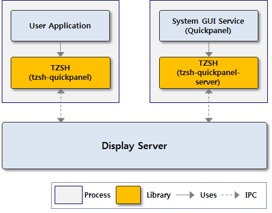

# Tizen Window System Shell

Tizen Window System Shell (TZSH) is an interface for manipulating windows of the system Graphical User Interface (GUI) services such as Quickpanel and Softkey. It provides C libraries that allow you to control windows of system GUI services and get notifications about the state changes of each window within an application.

The system GUI service runs different processes. Therefore, all the operations of TZSH are performed using the inter-process communication (IPC). It is needed to enable communication between the system GUI service processes and separated user application process using the display server. The following figure illustrates a simple software architecture of TZSH:

**Figure: Layer diagram for the Tizen Window System Shell**



To support each system GUI service in Tizen, TZSH provides the following libraries:

- **[TZSH-Quickpanel](./tzsh-quickpanel.md)**: For the Quickpanel window that shows notifications and system setup widgets.

- **[TZSH-Softkey](./tzsh-softkey.md)**: For the Softkey window that shows the device back and home buttons.

Most applications do not need to use the TZSH's functionalities. However, in some cases, certain applications may require to perform manipulation of system GUI service window. For example, media player application needs to close the Quickpanel window during playback of video. In this case, you can use the TZSH-Quickpanel library.

## Prerequisites

To use the functions and structures of the TZSH API, include the `<tzsh.h>` header file in your application:

```
#include <tzsh.h>
```

## Create TZSH Structures
Call `tzsh_create()` with the toolkit type used by your application to create the `tzsh_h` structure. The toolkit type selects the TZSH backend; `tzsh_create()` does not take a native window ID.

| Toolkit type | Description | Since |
| --- | --- | --- |
| `TZSH_TOOLKIT_TYPE_EFL` | Use the EFL toolkit. Deprecated since Tizen 11.0; use `TZSH_TOOLKIT_TYPE_TCORE_WAYLAND` for tizen-core-wl apps. | Tizen 3.0 |
| `TZSH_TOOLKIT_TYPE_TCORE_WAYLAND` | Use the tizen-core-wl toolkit. | Tizen 11.0 |

The following example uses a connected Tizen Core Wayland display to create an application window, get its native surface ID, and create a TZSH structure. Pass the surface ID to a TZSH sub-library when creating a service handler.

```
#include <tizen_core_wl.h>
#include <wayland-client.h>
#include <tzsh.h>

static void
init(tizen_core_wl_display_h display)
{
    tizen_core_wl_window_h window = NULL;
    tizen_core_wl_native_surface_h surface = NULL;
    tzsh_h tzsh = NULL;
    tzsh_window tz_win;

    if (tizen_core_wl_create_window(display, NULL, 0, 0, 640, 480, &window) != TIZEN_CORE_WL_ERROR_NONE)
        return;

    tizen_core_wl_window_show(window);

    if (tizen_core_wl_window_get_native_surface(window, &surface) != TIZEN_CORE_WL_ERROR_NONE || !surface)
        return;

    tz_win = (tzsh_window)wl_proxy_get_id((struct wl_proxy *)surface);
    tzsh = tzsh_create(TZSH_TOOLKIT_TYPE_TCORE_WAYLAND);
    if (!tzsh)
        return;

    /* Pass tz_win to a TZSH sub-library create function. */
}
```

## Destroy TZSH Structures
When TZSH structures are no longer needed, destroy the structures. To destroy the structures, use the following code:

```
static void
deinit(void)
{
    tzsh_destroy(tzsh);
}
```

## Related Information
- Dependencies
  - Since Tizen 3.0
