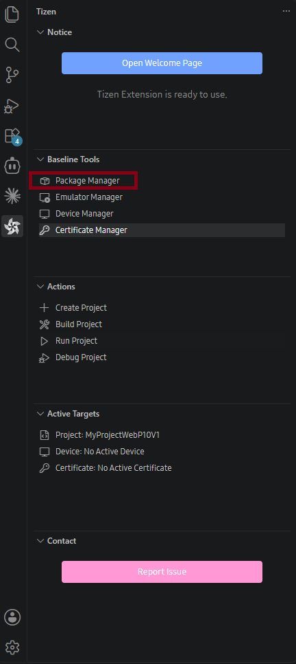
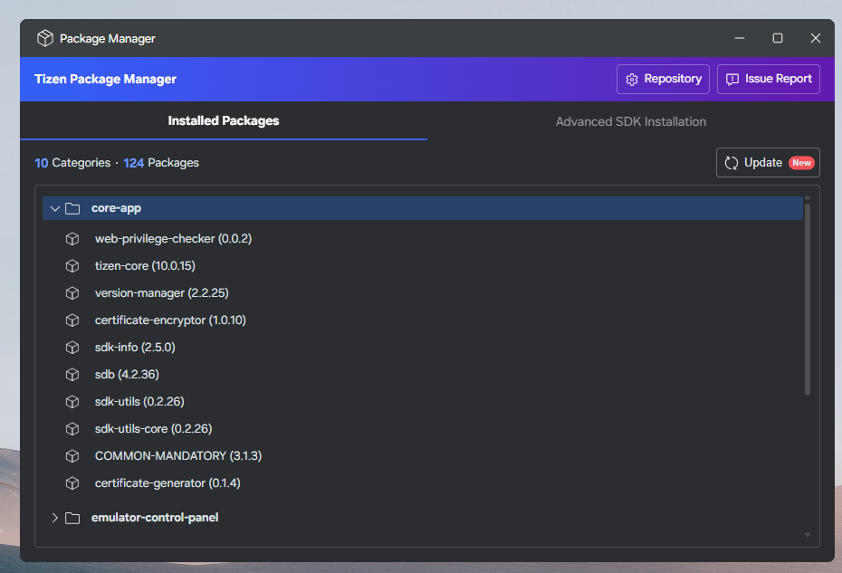
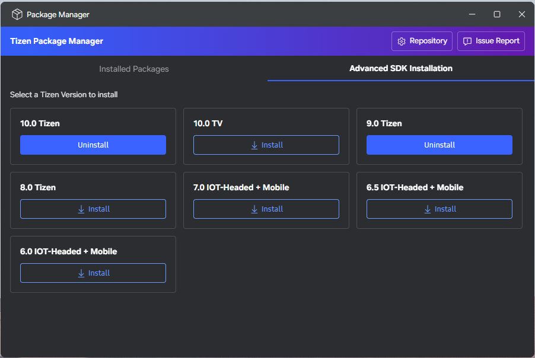
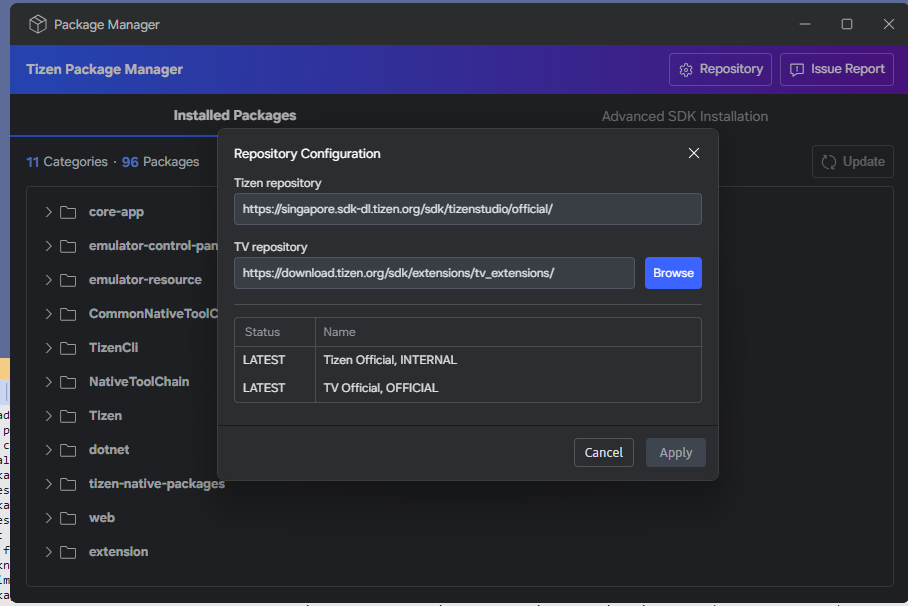
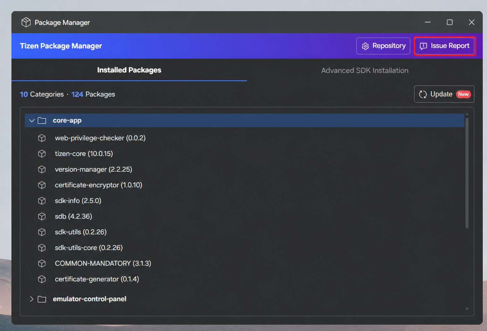

# Manage SDK packages

Use Package Manager to install, update, and remove Tizen platform packages, SDK components, extensions, and emulator images.

## Opening Package Manager

In the **Tizen** panel, under **Baseline Tools**, select **Package Manager**.

## Install or Update Packages

The **Installed Packages** tab lists installed packages by category and shows their versions. Expand a category to review its packages. When updates are available, select **Update** in the summary bar to install them.

## Install a Platform Version

Use **Advanced SDK Installation** to add or remove an entire Tizen platform version:

1. Select **Advanced SDK Installation**.
2. Select **Install** next to the platform version that you need.
3. To remove an installed version, select **Uninstall**.

The available versions include Tizen 10.0, 9.0, 8.0, 7.0, 6.5, 6.0, and TV extensions. Install the platform version and profile required by the application and target device.

## Configure Package Repositories

1. Select the **Repository** (gear) button in Package Manager.
2. Configure the Tizen repository for official SDK packages and the TV repository for TV extension packages or local ZIP files.
3. Select **Apply** after changing a repository URL.
4. Select **Update** in Package Manager to complete the repository update.

### Install TV packages from a local ZIP file

You can select a local `.zip` file as the TV repository to install TV SDK packages and an emulator image.

1. In Package Manager, select **Repository** to open **Repository Configuration**.
2. Select **Browse** next to **TV repository**, select the TV `.zip` file, and select **Open**.

   

3. Select **Apply** and wait for the repository configuration to finish applying.

   

4. Select **Update** in Package Manager and wait for the update to complete.

The package list in **Advanced SDK Installation** updates to reflect the TV packages from the ZIP file. The TV emulator also appears in Emulator Manager.

To run the emulator, open **Emulator Manager** from **Baseline Tools** in the **Tizen** panel, select the TV emulator, and select **Launch**. For more information, see [Launch and manage emulators](emulator-manager.md#launch-and-manage-emulators).

## Report an Issue

Select **Issue Report** in the upper-right corner of Package Manager to open the GitHub issues page and report an issue.

