# Set up Tizen SDK packages

The Visual Studio Extension for Tizen installs the core applications during its first-run setup. Use the **Tizen Package Manager** to install, update, and remove the platform packages, SDK components, extensions, and emulator images required by your projects.

Open it from **Tools > Tizen > Tizen Package Manager**.

## Install or Update Packages

The **Installed Packages** tab lists installed packages by category and shows their versions. Expand a category to review its packages. When updates are available, select **Update** in the summary bar to install them.

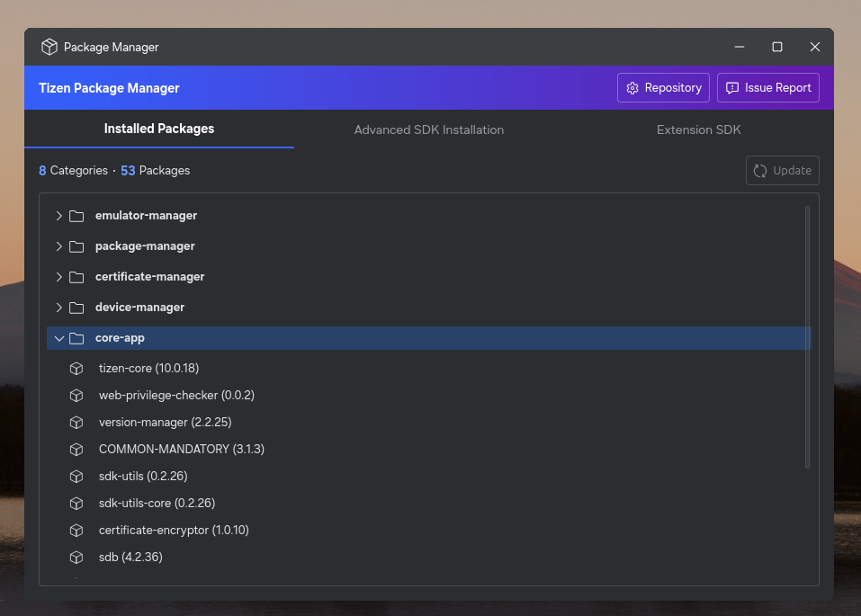

## Install a Platform Version

Use **Advanced SDK Installation** to add or remove an entire Tizen platform version:

1.  Open **Tools > Tizen > Tizen Package Manager**.
2.  Select **Advanced SDK Installation**.

    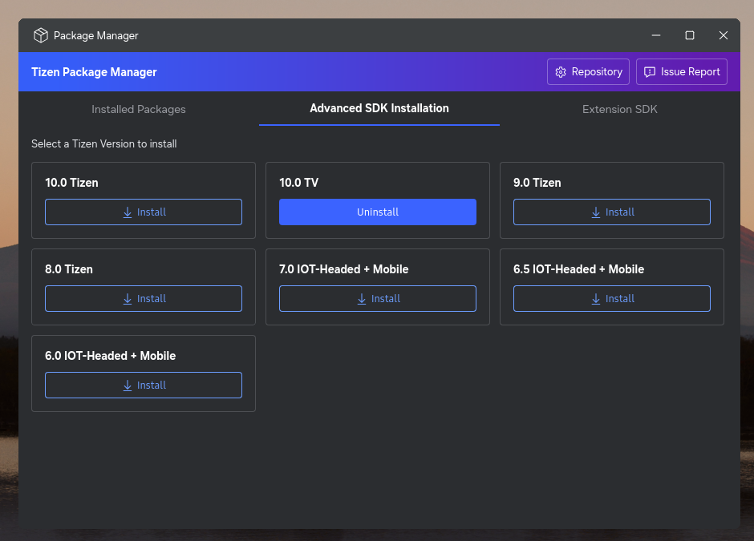

3.  Select **Install** next to the platform version that you need.
4.  To remove an installed version, select **Uninstall**.

The video below shows how to install a Tizen SDK platform version:

<video controls height="400">
  <source src="media/sdk-installation.mp4" type="video/mp4">
</video>

The available versions include Tizen 10.0, 9.0, 8.0, 7.0, 6.5, 6.0, and TV extensions. Install the platform version and profile required by the application and target device.

## Configure Package Repositories

1.  Select the **Repository** (gear) button in Package Manager.

    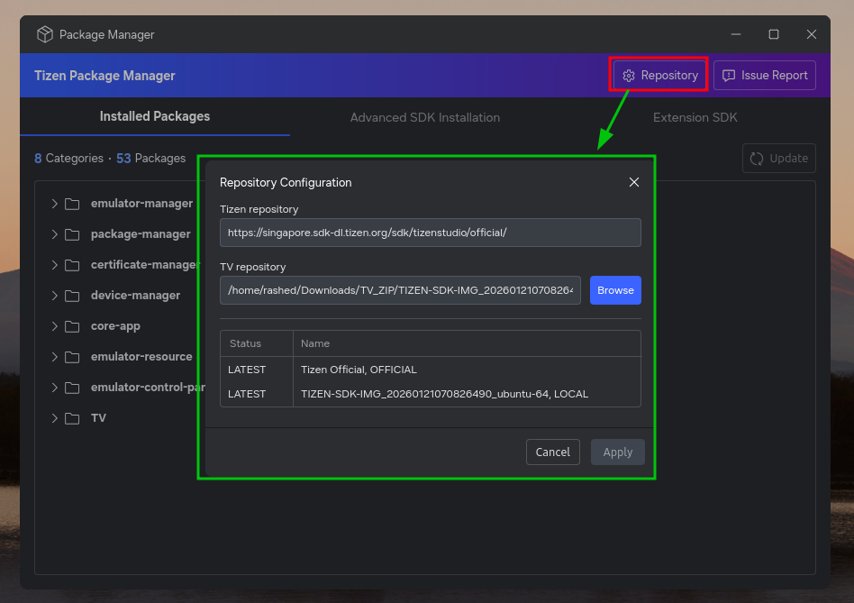

2.  Configure the Tizen repository for official SDK packages and the TV repository for TV extension packages or local ZIP files.
3.  Select **Apply** after changing a repository URL.
4.  Select **Update** in Package Manager to complete the repository update.

### Install TV packages from a local ZIP file

You can select a local `.zip` file as the TV repository to install TV SDK packages and an emulator image.

1.  In Package Manager, select **Repository** to open **Repository Configuration**.
2.  Select **Browse** next to **TV repository**, select the TV `.zip` file, and select **Open**.

    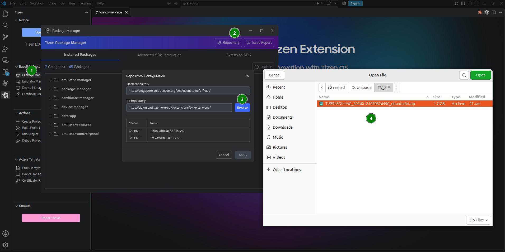

3.  Select **Apply** and wait for the repository configuration to finish applying.

    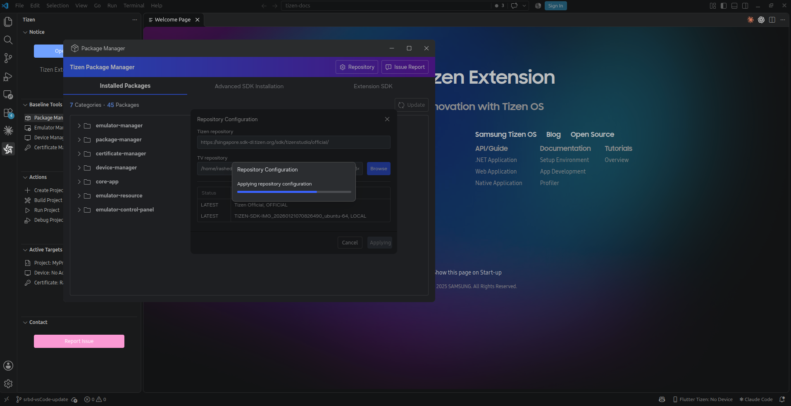

4.  Select **Update** in Package Manager and wait for the update to complete.

The package list in **Advanced SDK Installation** updates to reflect the TV packages from the ZIP file. The TV emulator also appears in Emulator Manager.

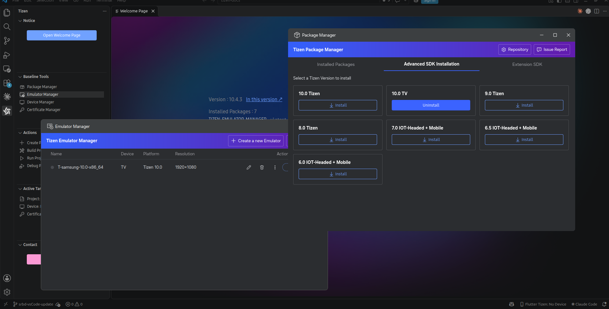

To run the emulator, open **Tools > Tizen > Tizen Emulator Manager**, select the TV emulator, and select **Launch**. For more information, see [Launch and manage emulators](tools/emulator-manager.md#launch-and-manage-emulators).

## Manage extension SDKs

Use **Extension SDK** in Package Manager to add external extensions, such as RTL TV Tools, and install their packages. It contains two tabs: **Repositories**, where you manage extension sources, and **Packages**, where you install and remove extension packages.

### Add an extension

1.  In Package Manager, select **Extension SDK**.
2.  Select **+ Add Extension**.
3.  Enter a name for the extension in **Name**.
4.  Select the browse (**...**) button next to **Repository URL**, select the extension's `.zip` file, and select **Open**. You can also enter a server URL in **Repository URL**.
5.  Select **Add** to register the extension.

    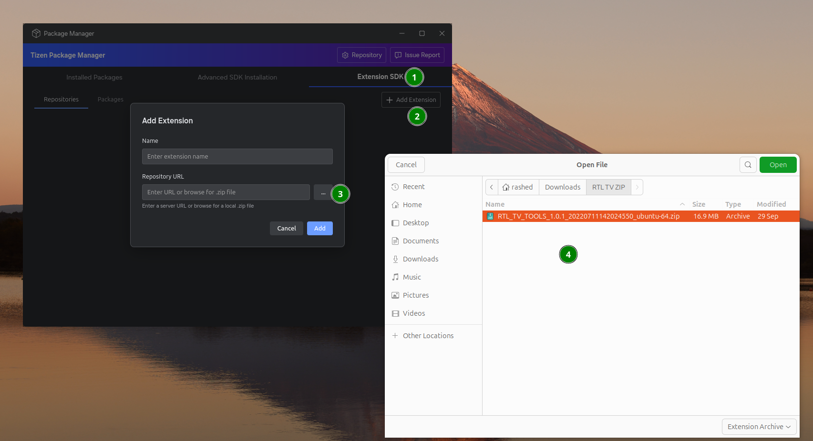

### Manage extension repositories

In the **Repositories** tab, select an extension to view **Selected Extension Details**, including its name, vendor, repository URL, and description.

Use the pencil icon in the extension's **Action** column to edit its configuration, or the trash icon to delete the repository entry.

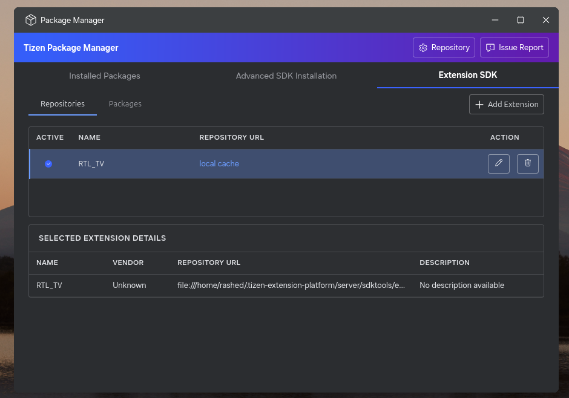

### Install and remove extension packages

1.  Select the **Packages** tab to view packages from the added extensions.
2.  Select a package to open **Package Details**. Review its name, description, version, vendor, extension name, installation status, and license information, when available.

    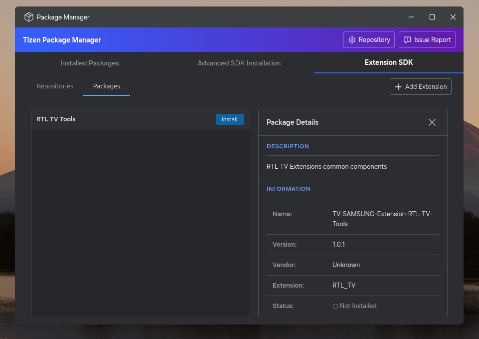

3.  Select **Install** next to the extension's package group and wait for installation to complete.
4.  Select the package again to verify that its status is **Installed** in **Package Details**.

    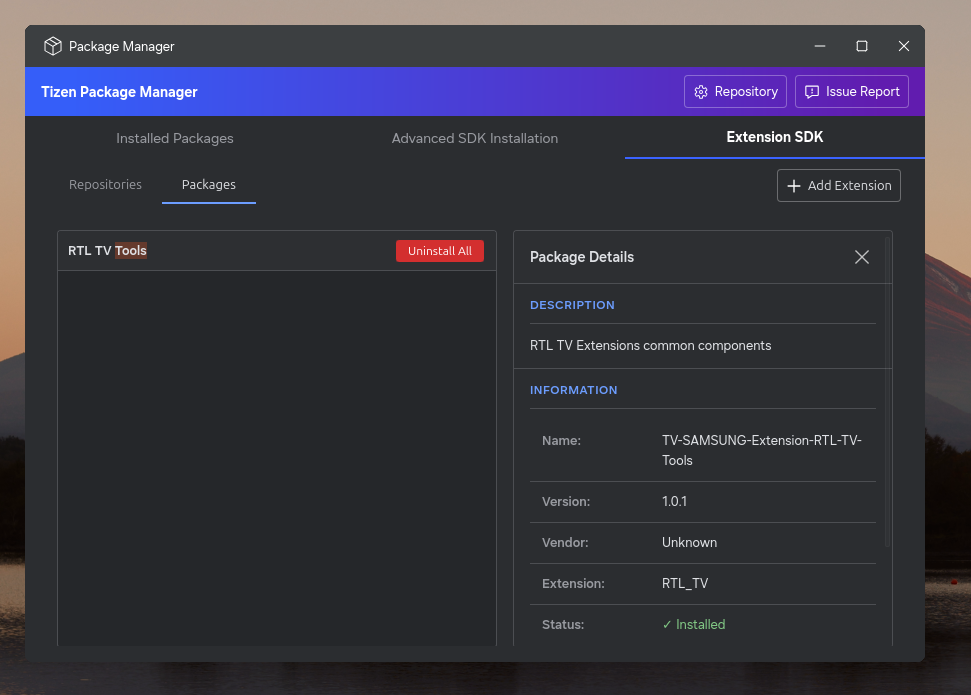

To remove the installed packages for an extension, select **Uninstall All** next to its package group.

## Report Issue for Package Manager

Select **Issue Report** in the upper-right corner of Package Manager to open the GitHub issues page and report an issue.

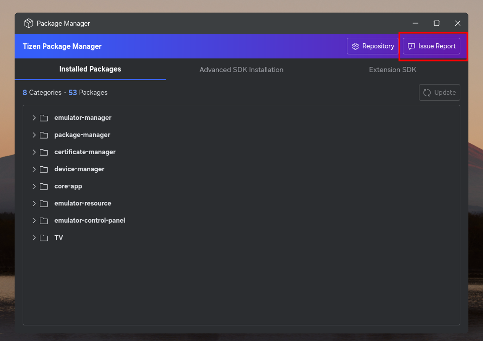

## Install emulator images

Install a platform image before creating an emulator:

1.  Open **Tools > Tizen > Tizen Emulator Manager**.
2.  Select **Create a new Emulator**.

    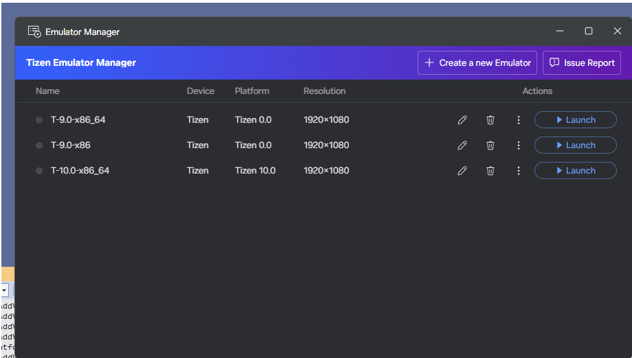

3.  In **Select a Platform Image**, select **Download** if the required image is not listed.

    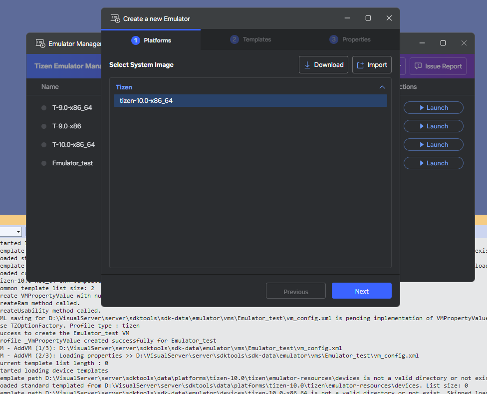

4.  Download the image, then continue creating the emulator.

For a custom system image, select **Import** in the **Select a Platform Image** dialog and provide its platform name, base platform, image format, and `.qcow2` or raw image file.

## Troubleshoot setup

-   Verify the extension in **Extensions > Manage Extensions** by searching for **Tizen**.

    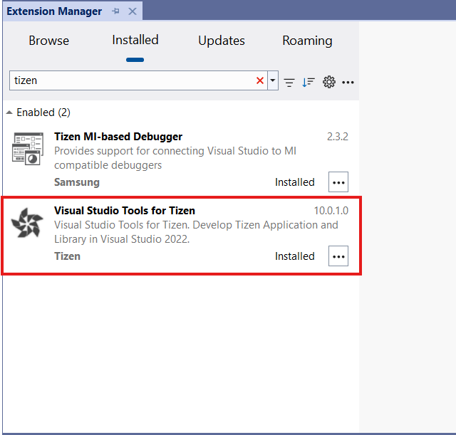

-   Confirm the first-run setup has completed and that the SDK resource path is writable. By default, it is `C:\Users\<username>\.tizen-extension-platform`.

-   If package downloads are blocked by a corporate firewall, allow access to the configured package repository over ports 80 and 443.
-   To make sure the Tizen SDK tools are installed correctly, check the tool path in **Tools > Options > Tizen > Tools**.

    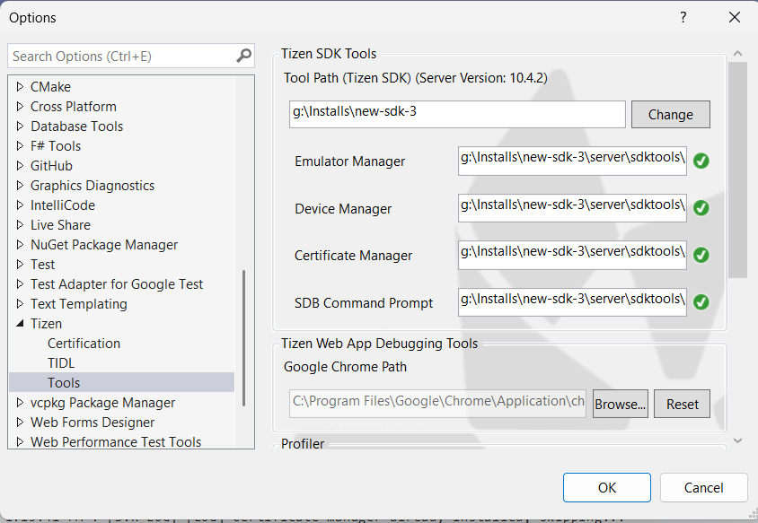

-   To verify that the Tizen project properties were copied correctly, make sure that `Tizen.NET.ProjectType.props` and `Tizen.NET.ProjectType.targets` are located in the `MSBuild\Tizen\VisualStudio` directory of your Visual Studio installation.

    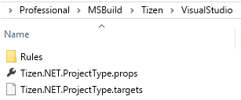
