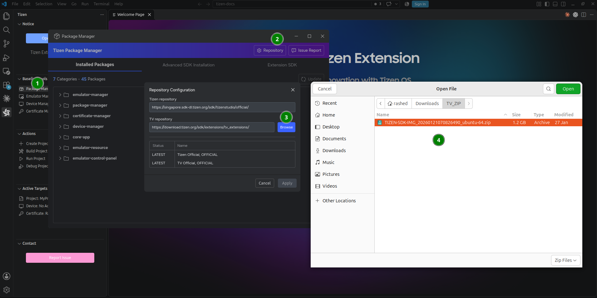
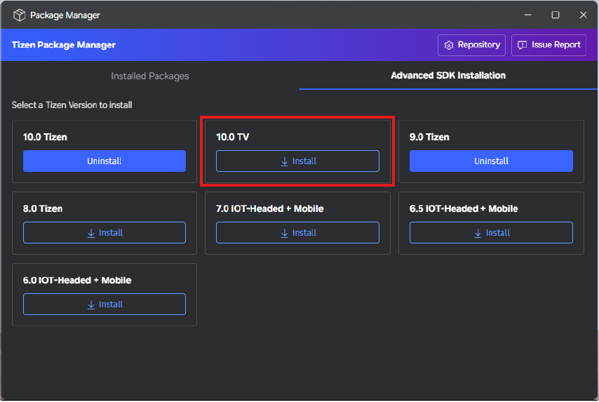
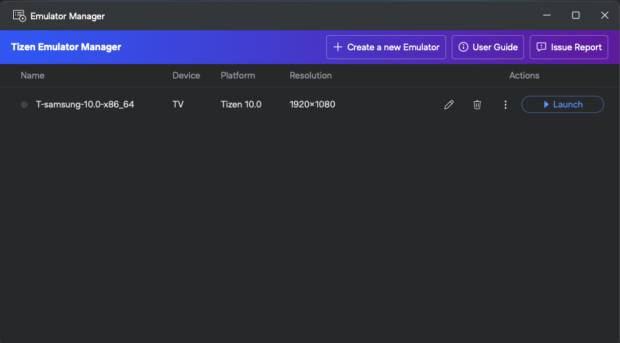

# Install Samsung Smart TV Extension

The Samsung Smart TV Extension allows developers to create applications for Samsung Smart TVs and emulate them for testing purposes.
It is an add-on SDK, which is installed using the Tizen Package Manager.

To install the Samsung Smart TV Extension, follow these steps:

1. In the Visual Studio menu, select **Tools > Tizen > Tizen Package Manager**.
2. Select **Repository** to open **Repository Configuration**. The default TV repository URL is displayed next to **TV repository**.
3. Keep or change the URL, or select **Browse** next to **TV repository** and select a local TV SDK `.zip` file.

   

4. Select **Apply** and wait for the repository update to complete automatically.
5. If you selected a repository URL(skip this step if you selected a local zip), select **Advanced SDK Installation**, then select **Install** next to the TV version that you need. Wait for the installation to complete.

   

6. Open **Tools > Tizen > Tizen Emulator Manager**. The TV emulator appears there for either installation source.

   
