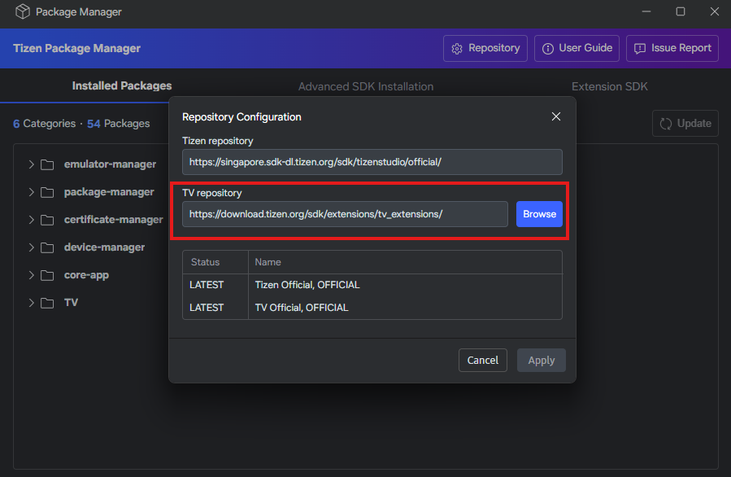
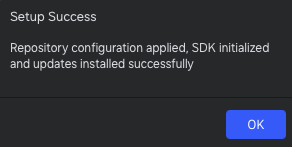
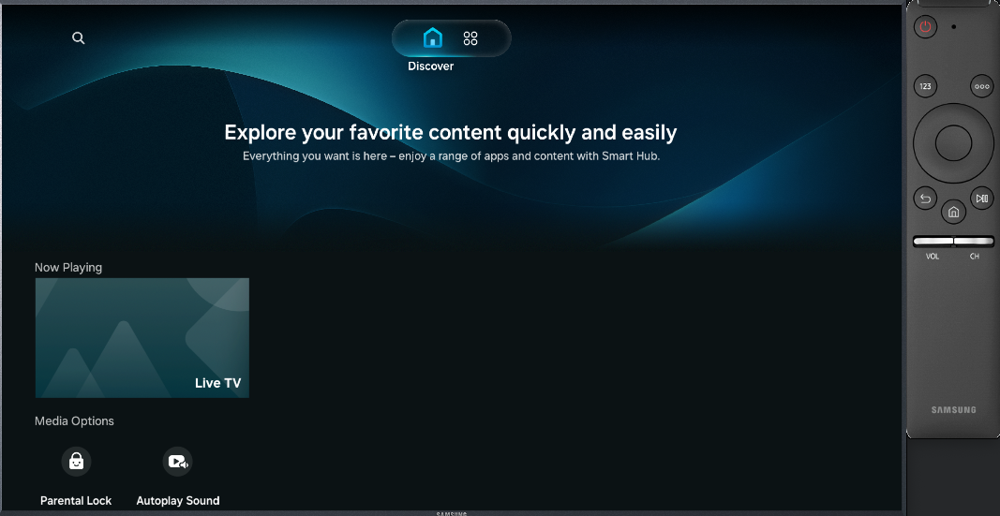
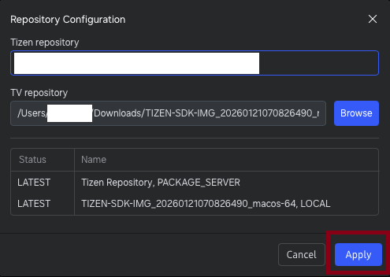

# Install Samsung Smart TV Extension

The Samsung Smart TV Extension allows developers to create applications for Samsung Smart TVs and emulate them for testing purposes.
It is an add-on SDK, which is installed using the Tizen Package Manager.

## Install from a repository URL

1. In the Visual Studio menu, select **Tools > Tizen > Tizen Package Manager**.
2. Select **Repository** to open **Repository Configuration**. The default TV repository URL is displayed next to **TV repository**.
3. Keep the default TV repository URL or change it. If you change it, select **Apply**. If you keep it, **Apply** remains disabled.

   

4. If you changed the URL, wait for the repository update to complete automatically.

   

5. Select **Advanced SDK Installation**, then select **Install** next to the TV version that you need. Wait for the installation to complete.

   

6. Open **Tools > Tizen > Tizen Emulator Manager** and select **Launch** next to the TV emulator.

   

7. Check that the TV emulator gets launched.

   

## Install from a local ZIP file

1. In the Visual Studio menu, select **Tools > Tizen > Tizen Package Manager**.
2. Select **Repository** to open **Repository Configuration**.
3. Select **Browse** next to **TV repository**, select a local TV SDK `.zip` file, and select **Apply**.

   

   

4. Wait for the repository update to complete automatically.

   

5. Open **Tools > Tizen > Tizen Emulator Manager** and select **Launch** next to the TV emulator.

   

6. Check that the TV emulator gets launched.

   
